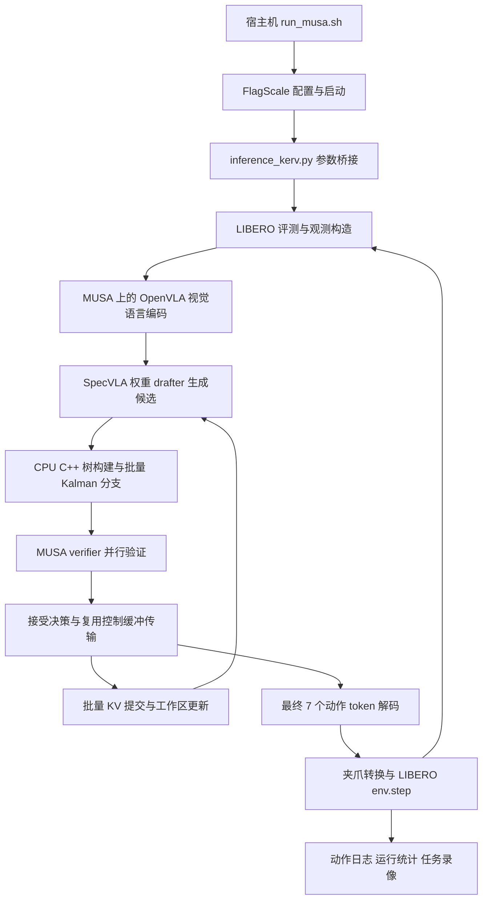

# KERV 在摩尔 MTT S5000 上的部署、算子适配与推理优化交付指南

**文档用途：甲方技术交付、部署复现、指标核验及后续维护。**

**当前甲方报告入口（2026-10-28）：** [摩尔适配、推理优化与保精度压缩技术报告](docs/acceptance/MOORE_TECHNICAL_REPORT_20261028.md)。报告统一了组件分工、七类量化候选、保留配置、配对指标、操作与证据索引，并逐项对照 TestOutline 说明验收状态。当前结论为：无损 BF16 存储配置减少 allocated 峰值 2.107 GB，模型均值延迟增加 19.37%；本轮没有通过任务筛选的有损方案。下方按日期保留的历史倍率使用不同参考，不作为当前配置的综合加速结论。

> **2026-10-28 任务成功率优先复测：** 七类有损候选均未通过抽屉试点；真实树GPTQ、高位宽及近零量化都保留失败记录，未替换推荐配置。新解码原型也未取得稳定Linear收益。本轮重新验证原96投影无损BF16存储：BF16与候选均170步成功、动作及观测完全一致，allocated峰值节省2.107GB；排除首步模型均值261.86→312.57ms（+19.37%）。最终回归37项通过。详见[本轮报告](docs/acceptance/MOORE_TASK_AWARE_QUANTIZATION_20261028.md)和[操作说明](src/docs/MUSA_TASK_AWARE_QUANTIZATION.md)。

> **2026-10-27 精度优先配置：** 追加96个MLP投影的无损BF16存储压缩。两个独立冷启动任务中，BF16与候选均成功，262/262动作、raw数值及观测一致，实际allocated显存峰值少约2.10GB。代价为本轮排除首步的平均模型耗时256.77→309.33ms（+20.47%）。这是保持原BF16权重的存储方案，不能称为INT8精度验收通过；原75投影INT8在同输入筛选中仍仅111/141一致。详见[精度优化报告](docs/acceptance/MOORE_PRECISION_REFINEMENT_20261027.md)及[操作指南](src/docs/MUSA_PRECISION_FIRST.md)。

> **2026-10-27 算子与链路继续优化：** 新增原生 MUSA 向量解码并完成真实权重及边界验证；因收益不足保留为实验实现。最终通过共享重复 Kalman 历史计算，在相同量化策略与 guarded Softmax 下，三轮 423/423 动作及 token 一致，模型平均 307.10→263.18 ms（1.1669×），pipeline 平均 318.85→274.87 ms（1.1600×）。详见[本轮报告](docs/acceptance/MOORE_QUANTIZED_OPERATORS_FOLLOWUP_20261027.md)和[操作说明](src/docs/MUSA_QUANTIZED_OPERATORS_FOLLOWUP.md)。该倍率相对上一版安全量化入口；原策略对 BF16 的质量验收仍未通过。

> **2026-10-27 新版复核：** 官方 muDNN 3.4.0 在本机隔离进程中共 12,000 次未复现原 Softmax 错误；旧版 3.3.0 配合 Runtime 5.2.0 仍出现 3/3000 次错误。按要求已关闭 PR #158，未合并。详见[新版对照报告](docs/acceptance/MOORE_SOFTMAX_LATEST_VERSION_20261027.md)。本轮保持原宿主驱动，没有完成整套 SDK 5.2.0 或新框架的业务验收。

> **2026-10-27 Softmax 进一步定位：** 纯 C++ 直接调用 muDNN 已独立复现；通过官方解包工具完整反汇编目标内核 1,119 条指令。有限范围的 torch_musa 规避补丁已提交 [PR #158](https://github.com/MooreThreads/torch_musa/pull/158)：原始实现同一回归失败，候选代码 3,000 次全概率检查无错、新增回归 19 项通过。内部故障语句仍未确定，不能把缺失 barrier 作为已确认原因。详见[独立复现与二进制分析报告](docs/acceptance/MOORE_SOFTMAX_ROOTCAUSE_20261027.md)及[上游提交记录](docs/upstream/torch_musa_softmax/README.md)。

> **2026-10-27稳定性定位：** 已独立复现当前摩尔原生Softmax偶发概率错误，并提供保持正常行bit、仅重算异常行的修复入口。三轮完整回放423/423动作及token与特定历史对照轮一致，真实推理实际修复74行异常概率，回归62通过/1跳过。详见[定位与修复报告](docs/acceptance/MOORE_SOFTMAX_DIAGNOSIS_20261027.md)。量化质量门禁及此前IndexSelect非法地址仍未关闭；不沿用旧倍率作为新入口性能结论。

> **2026-10-27量化链路继续优化：** 通过实际剖析，将FlagOS/KERV批量树缓冲构建接入量化入口，详见[链路优化报告](docs/acceptance/MOORE_QUANTIZED_PIPELINE_REPORT_20261027.md)和[操作指南](src/docs/MUSA_QUANTIZED_PIPELINE.md)。同一量化policy三轮模型倍率为1.637×（参考上一轮row后端）；原量化精度验收仍未通过，默认BF16保留。

> **2026-10-27量化算子实测：** 已实现专用INT8/BF16保护组解码及融合GEMM/GEMV试验，见[算子报告](docs/acceptance/MOORE_QUANTIZED_KERNEL_REPORT_20261027.md)和[操作指南](src/docs/MUSA_QUANTIZED_KERNELS.md)。热Linear有收益，但三轮合并整模型仅0.998×、417/423动作一致，未通过性能门禁；保留实验入口，默认BF16不变。

> **2026-10-26校准量化实测：** 已实现激活校准、GPTQ误差补偿及BF16保护组，见[最新试验报告](docs/acceptance/MOORE_CALIBRATED_QUANTIZATION_REPORT_20261026.md)和[操作指南](src/docs/MUSA_CALIBRATED_QUANTIZATION.md)。首候选省约2.607GB allocated/2.655GB reserved，但141帧仅107动作一致、任务未完成；追加候选结果和BF16基线重复性另列，尚不能宣称精度损失很小，默认BF16保留。

> **量化机制V2设计：** 新增[低精度损失量化机制方案](docs/acceptance/QUANTIZATION_DESIGN_V2_20261026.md)，采用激活校准、GPTQ补偿及投影内部BF16保护组。真实权重静态预算约2.70GB节省；这是设计估算，尚未完成新算法精度实测，不替换既有结果或默认配置。

> **2026-10-26混合精度补充：** 已实现按投影选择的INT8/BF16混合量化及BF16无损存储压缩，详见[最新试验报告](docs/acceptance/MOORE_MIXED_QUANTIZATION_REPORT_20261026.md)和[操作指南](src/docs/MUSA_MIXED_QUANTIZATION.md)。两轮INT8混合策略仍未通过首个闭环；无损存储的192个投影逐bit还原，但optimized运行时回放为139/141动作一致、完整任务未完成。不能将权重无损写成端到端精度通过，追加native控制在170步成功，170条动作/token及观测全部一致，allocated/reserved峰值分别减少2.897/2.894GB。该路线属于无损存储压缩，不是INT8混合量化通过；仅验证单task/state/seed，默认BF16配置保留。

> **2026-10-26量化补充：** 已新增MUSA W8A16实验入口，详见[量化补充报告](docs/acceptance/MOORE_QUANTIZATION_REPORT_20261026.md)和[操作指南](src/docs/MUSA_QUANTIZATION.md)。group128在state0相对真实SpecVLA的allocated峰值少3.421GB、reserved少1.793GB；三个状态任务成功0/3，group32在state0也未完成。因此当前量化候选不替换默认BF16，也不能写成质量验收通过。

> **2026-10-19复测更新：** 请优先阅读[摩尔节点阶段测试报告](docs/acceptance/MOORE_TEST_REPORT_20261019.md)及[执行与复算说明](docs/acceptance/README.md)。新三组闭环对照仅seed 7的170个动作全部一致，seed 17/27出现分歧；固定输入三轮回放为422/423动作一致。真实SpecVLA对照中接受长度及显存节省目标未达到。下面的2026-09-30单回合结果作为历史记录保留，不能据此宣称多轮无损优化或整体验收通过。

| 项目 | 内容 |
| --- | --- |
| 验证日期 | 2026-09-30 |
| 实际硬件 | 单张 MTT S5000，MUSA 后端，BF16 推理 |
| 推理主干 | KERV；使用 SpecVLA 的 LIBERO-Goal drafter 权重 |
| 启动及运行时 | FlagScale 启动，FlagOS/KERV Runtime 优化，`torch_musa` 执行 |
| 验证任务 | LIBERO-Goal，第 0 个任务、第 0 个初始状态、1 次 episode |
| 任务内容 | `open_the_middle_drawer_of_the_cabinet`，打开柜子中间抽屉 |
| 交付结论 | 原生基线和最终优化配置均在第 170 步成功；170 条动作及动作 token 一致 |
| 主要性能结果 | 排除首步后的平均动作推理耗时从 0.522852 秒降至 0.230204 秒，本次对比为 2.2713 倍 |
| 测试结果 | 18 项回归：17 项通过，1 项因当前驱动不支持 Graph 捕获而跳过 |
| 本文路径 | 宿主机 `/root/KERV/README.md` |

本文中的结果来自本工作区的真实权重、真实设备和 LIBERO 仿真记录。**2.27 倍是本次单任务、排除首步后的动作推理耗时比**，不表示整套 LIBERO 的平均加速，也不表示从程序启动到录像保存的总耗时比。上游仓库 README 的论文指标属于上游实验，不属于本次交付验收指标。

## 目录

1. [交付范围与组件关系](#1-交付范围与组件关系)
2. [验收指标与计时口径](#2-验收指标与计时口径)
3. [硬件、软件与源码版本](#3-硬件软件与源码版本)
4. [工作区与文件索引](#4-工作区与文件索引)
5. [技术架构与动作生成链路](#5-技术架构与动作生成链路)
6. [芯片、框架和依赖适配](#6-芯片框架和依赖适配)
7. [算子及推理优化技术说明](#7-算子及推理优化技术说明)
8. [优化门禁与问题处理记录](#8-优化门禁与问题处理记录)
9. [现有工作区直接操作](#9-现有工作区直接操作)
10. [新工作区部署复现](#10-新工作区部署复现)
11. [模型准备与参数一致性检查](#11-模型准备与参数一致性检查)
12. [基线、优化与指标复核流程](#12-基线优化与指标复核流程)
13. [回归测试与验收判定](#13-回归测试与验收判定)
14. [日志、录像和复现证据](#14-日志录像和复现证据)
15. [常见问题与维护方法](#15-常见问题与维护方法)
16. [甲方汇报技术大纲与验收边界](#16-甲方汇报技术大纲与验收边界)

## 1. 交付范围与组件关系

### 1.1 本次完成的工作

本次工作首先完成 KERV 在 MUSA 上的原生 BF16 推理，再适配并筛选算子和运行时优化，最终通过完整闭环任务验证。交付内容包括：

- 单张 MTT S5000 的 Docker 推理环境、虚拟环境和 LIBERO 无显示器仿真配置。
- KERV 设备选择、随机种子、模型加载、eager attention 和 MUSA 同步计时适配。
- 公开 OpenVLA verifier 与 SpecVLA drafter 权重的准备、来源记录和 drafter 参数检查。
- FlagScale 启动桥接、原生/优化双配置及异常退出码传递修复。
- QKV/Gate-Up 合并、RoPE 融合、局部 Add-RMSNorm 和原生原位 SwiGLU。
- C++ 草稿树/验证树构建、批量 Kalman、批量 KV 提交及解码工作区复用。
- 提示词 token 缓存、持久化 drafter KV、设备/CPU 控制缓冲区复用。
- 数值和行为门禁、真实形状微基准、完整任务验收、动作一致性及实际算子命中记录。
- 可复跑脚本、测试日志、任务录像、版本清单和本操作指南。

### 1.2 KERV、SpecVLA、FlagScale、FlagOS 的关系

| 组件 | 本次承担的职责 | 交付说明 |
| --- | --- | --- |
| KERV | 草稿树、并行验证、动态接受阈值、Kalman 补偿及动作生成 | 推理主干仍是 KERV |
| SpecVLA | LIBERO-Goal drafter 权重来源 | 未把整个运行工程切换成 SpecVLA 项目 |
| OpenVLA verifier | 视觉语言编码和候选动作验证 | 使用公开的 LIBERO-Goal 微调权重 |
| FlagScale | 配置组织、启动命令和运行日志管理 | 调用本地 KERV 自定义推理入口 |
| FlagOS/KERV Runtime | 已有算子注册、融合接口和运行时优化机制 | 在本机完成 MUSA 路径适配与筛选 |
| FlagGems v3.0 | 可选算子注册及实验验证 | 已安装并保存兼容补丁；最终全局 RMSNorm 替换关闭 |
| `torch_musa` | 张量运算、GEMM、设备流、事件、同步和内存管理 | 最终推理的实际芯片后端 |
| Triton MUSA | RoPE、局部 Add-RMSNorm 等定制内核执行 | 最终启用路径有实际命中证据 |
| LIBERO / MuJoCo / robosuite | 任务、初始状态、动作执行和仿真渲染 | OSMesa 使用 CPU 无显示器渲染 |

FlagScale 配置中的 `experiment.task.backend: vllm` 用于选取其启动 runner；实际入口是 `src/runtime_opt/FlagScale/inference_kerv.py`，最终模型由本地 KERV/OpenVLA 代码加载。**本次没有通过 vLLM 引擎执行 OpenVLA 模型。**

最终方案需要设备 API、内核入口、数据类型和性能配置的具体适配，不能描述为“只打开 FlagOS 开关就自动完成全部芯片适配”。本机验证对象是摩尔 MUSA，昇腾硬件及其适配效果未在本次环境中验收。

### 1.3 保留双配置的目的

| 配置 | 文件 | 用途 |
| --- | --- | --- |
| `native` | [kerv_libero_goal_musa.yaml](src/runtime_opt/FlagScale/configs/kerv_libero_goal_musa.yaml) | 保留 KERV 算法流程，关闭额外融合和系统优化，作为 MUSA 基线 |
| `optimized` | [kerv_libero_goal_musa_optimized.yaml](src/runtime_opt/FlagScale/configs/kerv_libero_goal_musa_optimized.yaml) | 启用本次通过数值、行为和性能筛选的优化组合 |

`native` 不是普通 OpenVLA 自回归，也不是论文中的 Naive VLA+SD：它仍包含 KERV 的草稿、验证、动态阈值和 Kalman 机制。本次 2.27 倍比较的是 **KERV 原生 MUSA 配置与 KERV 优化 MUSA 配置**。

## 2. 验收指标与计时口径

### 2.1 完整任务条件

| 条件 | 取值 |
| --- | --- |
| 任务套件 / 任务编号 | `libero_goal` / `task_id=0` |
| 任务初始状态 | 套件提供的第 0 个初始状态 |
| trial / episode | 1 次 |
| 随机种子 | `7` |
| 可见加速设备 | `musa:0`，1 张 MTT S5000 |
| 推理精度 | BF16；未启用 W8A16、4bit 或 8bit 量化 |
| Attention | eager attention |
| 开始前仿真等待 | 10 个稳定化步骤；不算在 170 个策略动作内 |
| 策略动作上限 | 220 |
| 规划时域 `max_planning_steps` | 220 |
| 成功条件 | LIBERO 环境执行动作后返回 `done=True` |
| 最终结果 | 两个配置均在第 170 个策略动作后完成任务 |

### 2.2 核心指标表

下表采用动作日志重算的结果，展示 6 位小数；原始 JSON 保留更多有效位。

| 指标 | 原生基线 | 最终优化 | 解释 |
| --- | ---: | ---: | --- |
| 执行验收 `execution_passed` | `true` | `true` | 动作/运行记录、数值和录像检查通过 |
| 任务成功 `task_success` | `true` | `true` | 同一任务均成功 |
| 完成动作数 | 170 | 170 | 最后一个动作也是成功动作 |
| 有效动作及运行记录 | 170 / 170 | 170 / 170 | 两类记录逐步对应 |
| 单步动作维度 | 7 | 7 | 原始及执行动作均为有限数值 |
| 首步动作推理耗时 | 10.207784 秒 | 9.259602 秒 | 包含首次推理的懒初始化和内核预热 |
| 全部 170 步平均推理耗时 | 0.579823 秒 | 0.283318 秒 | 包含首步 |
| 排除首步后的样本数 | 169 | 169 | 第 2 至第 170 个策略动作 |
| 排除首步后的平均推理耗时 | **0.522852 秒** | **0.230204 秒** | 本次主要性能指标 |
| 排除首步后的中位数 | 0.519104 秒 | 0.236641 秒 | 对极慢步骤的敏感性更低 |
| 排除首步后的 P95 | 0.925780 秒 | 0.349806 秒 | 采用 nearest-rank 百分位算法 |
| 全部动作推理耗时之和 | 98.569826 秒 | 48.164111 秒 | 只累计各动作的测量区间，不是程序总耗时 |
| 验证周期数 | 488 | 489 | 相差 1 次，不能宣称内部过程逐操作相同 |
| 强制 Kalman 补偿动作数 | 42 | 42 | 统计 `forced_kalman=True` 的动作 |
| 对齐步骤的原始动作一致数 | — | 170 / 170 | 原始七维动作逐元素相同 |
| 对齐步骤的动作 token 一致数 | — | 170 / 170 | 每步最终 7 个动作 token 相同 |

### 2.3 加速及降幅计算

本次主要加速指标使用排除首步后的平均值：

```text
平均动作推理加速比
  = 0.5228523210727075 / 0.23020419399061146
  = 2.2712545414964564 倍

平均动作推理延迟降幅
  = (1 - 0.23020419399061146 / 0.5228523210727075) × 100%
  = 55.97146943551592%

P95 延迟加速比
  = 0.9257804593071342 / 0.3498061643913388
  = 2.6465527299039686 倍

P95 延迟降幅
  = 62.2149980727463%
```

如果包含首步，全部动作平均耗时比为 **2.0465 倍**，延迟降幅为 **51.1371%**。这一指标与 2.2713 倍使用不同样本口径，应分别标注。

### 2.4 计时边界

正式计时定义以 [openvla_utils.py](src/openvla/experiments/robot/openvla_utils.py) 中 `get_vla_action` 的代码为准：

```text
图像及提示词 processor 处理、输入构造、运行上下文准备
    ↓ 以上 CPU 工作先于计时起点
start_time = time.perf_counter()
    ↓
vla.predict_action(...)
    ├─ 模型内部视觉/语言处理
    ├─ 草稿生成、Kalman 分支和候选树
    ├─ verifier 验证、接受与控制值传输
    ├─ KV 更新及后续草稿
    └─ 最终动作 token 与动作解码
    ↓
同步当前 MUSA 设备
end_time = time.perf_counter()
    ↓
latency_seconds = end_time - start_time
    ↓ 以下在计时区间外
夹爪动作转换、env.step、后续仿真渲染、动作日志和录像保存
```

因此，指标包含模型内部动作预测及其同步等待，**不包含模型权重加载、此前的图像裁剪/CPU processor 工作、仿真步进、日志写入和录像保存**。因为起点没有额外的设备预同步，若前面的输入传输已经异步排队，其尚未完成的设备工作可能被终点同步覆盖；不能把该数值解释为纯 GPU kernel 时间。

首步的额外耗时主要对应首次实际推理的内核编译/预热、懒初始化和缓存分配；权重加载在循环前完成，未计入首步动作的测量区间。排除首步也不代表剩余步骤完全没有动态形状编译，未再额外剔除慢步骤。

部分早期 JSON 的 `timing_note` 使用了“包含预处理”等概括表述；甲方报告采用本节依据计时代码明确的边界，历史原始数值不变。摘要工具已修正这一说明文字，未来新生成的摘要使用上述边界；没有改变推理执行或计时逻辑。

### 2.5 数据来源及统计规则

| 数据 | 来源 |
| --- | --- |
| 每步动作、终止标志、同步耗时 | 每个运行目录的 `actions.jsonl` |
| 动作 token、接受长度、验证周期、Kalman 和缓存计数 | `runtime_stats.jsonl` |
| 单次验收汇总 | `acceptance.json` |
| 基线与优化的派生指标 | [musa_optimization_comparison.json](outputs/musa_optimization_comparison.json) |
| 版本、权重来源、测试、源码哈希 | [reproducibility-optimized.json](outputs/reproducibility-optimized.json) |

P95 算法：将 169 个样本按升序排序，选取第 `ceil(0.95 × 169)=161` 个样本。均值和中位数同样来自这 169 条记录。

完整动作日志包含终止成功的第 170 步。上游评测脚本在 `done=True` 时先退出，再向部分传统计时数组追加数据，因此控制台 `[Timing]` 可能只显示 169 条，并且包含首步、缺少终止步。正式指标使用 `actions.jsonl` 重算，不能混用控制台均值与本表均值。

### 2.6 结论适用范围

本次是各配置一条完整轨迹的对比，且最终动作相同、成功步数相同。可以提交“本次单任务平均动作推理加速 2.27 倍，轨迹动作一致”的结论；不能据此提交“整个 LIBERO 套件成功率 100%”“所有任务无精度损失”或“生产吞吐稳定提升 2.27 倍”。

测试期间没有连续保存峰值显存、平均 GPU 利用率、功耗或能耗，也未对单项优化做完整闭环消融。因此本文不填充这些指标，不把整体 2.27 倍拆分归因给某一个算子。

## 3. 硬件、软件与源码版本

### 3.1 验证环境

| 类别 | 本机记录 |
| --- | --- |
| CPU | 2 × AMD EPYC 9T34 64-Core Processor，标称共 256 逻辑 CPU |
| 主机内存 | 约 2267.30 GiB；这是本机资源规模，不是已验证的最低内存要求 |
| 加速卡 | MTT S5000，验收容器内可见 1 张 |
| 卡显存容量 | `mthreads-gmi` 报告 81920 MiB，约 80 GiB；非运行峰值用量 |
| 驱动 | `3.3.5-server` |
| 设备查询工具 | `mthreads-gmi 2.3.2` |
| 基础镜像 | `registry.mthreads.com/mcconline/musa-pytorch-release-public:rc5.1.0-v2.9.1-S5000-py310` |
| 工作镜像 | `kerv-musa:local`；历史验收记录短镜像 ID 为 `4e2c389dae50` |
| 专用容器 | `kerv-musa-runtime` |
| Docker runtime | `mthreads` |
| 共享内存 | 容器创建参数 `--shm-size=8g` |
| GPU 可见性 | 创建时 `MTHREADS_VISIBLE_DEVICES=0`；容器内逻辑编号 `musa:0` |
| Python | 基础镜像 Python 3.10，使用 `/workspace/.venv/bin/python` |
| CPU 渲染 | OSMesa；`MUJOCO_GL=osmesa`、`PYOPENGL_PLATFORM=osmesa` |
| CPU 线程设置 | 镜像 `OMP_NUM_THREADS=8`，TensorFlow intra/inter 线程为 4 / 2 |

### 3.2 关键依赖

| 依赖 | 验证版本 | 来源/要求 |
| --- | --- | --- |
| PyTorch | 2.9.1 | 继承摩尔基础镜像，不安装 CUDA 版 torch 覆盖 |
| `torch_musa` | 2.9.1 | 继承基础镜像 |
| torchvision | `0.24.1+03b35c9` | 继承与 vendor torch 匹配的构建 |
| Triton | 3.2.0 | 基础镜像 MUSA 构建 |
| FlagGems | 3.0 / v3.0 | 固定源码，editable 安装，附兼容补丁 |
| Transformers | 4.40.1 | 配合本地 KERV/OpenVLA 模型类 |
| timm | 0.9.10 | 视觉模型依赖 |
| NumPy | 1.26.4 | 与当前仿真及 TensorFlow 环境匹配 |
| TensorFlow CPU | 2.15.0 | 环境依赖；VLA 主要推理由 torch_musa 执行 |
| MuJoCo | 2.3.7 | 仿真 |
| robosuite | 1.4.0 | 仿真 |
| gdown | 6.4.1 | SpecVLA 公开 Google Drive 权重准备 |
| CMake | 3.31.6 | 构建及依赖兼容 |

直接安装项见 [requirements-musa.txt](src/requirements-musa.txt)，最终环境完整版本见 [requirements-musa-optimized.freeze.txt](outputs/requirements-musa-optimized.freeze.txt)。后者包含 vendor wheel 和本地 editable 路径，用于审计，不应不加区别地在其他平台执行 `pip install -r`。

### 3.3 固定源码版本

| 组件 | 上游仓库 | 本次固定 revision |
| --- | --- | --- |
| KERV | [zhengzihaoPKU/KERV](https://github.com/zhengzihaoPKU/KERV) | `4abb3dfdbe24783a738a23a893a6bd374beca0a3`，另有本次本地适配修改 |
| FlagScale | [flagos-ai/FlagScale](https://github.com/flagos-ai/FlagScale) | `f8e9a62c499d526a6ffa47f533bcf342330b7326` |
| SpecVLA | [PineTreeWss/SpecVLA](https://github.com/PineTreeWss/SpecVLA) | `56ef2985e25c7903d2759254efb754327fb975f7`，用于权重来源追溯 |
| LIBERO | [Lifelong-Robot-Learning/LIBERO](https://github.com/Lifelong-Robot-Learning/LIBERO) | `8f1084e3132a39270c3a13ebe37270a43ece2a01` |
| FlagGems | [flagos-ai/FlagGems](https://github.com/flagos-ai/FlagGems) | v3.0，`ed8c864062f7d037d3de6574df8895f45a60fd53` |

KERV 当前适配代码并不只存在于上游 commit 中。新环境应接收本次交付的 `src/`、补丁和配置；仅检出原始 KERV commit 不能复现最终适配结果。源码文件哈希见历史复现记录；本指南及后续文档编辑与实际执行时的源码版本应分别保存。

### 3.4 权重来源和校验

| 模型 | 来源 | 固定信息 |
| --- | --- | --- |
| Verifier | [openvla/openvla-7b-finetuned-libero-goal](https://huggingface.co/openvla/openvla-7b-finetuned-libero-goal) | revision `fa5ae1e7509348889295bba8e08621d8b55e9baf` |
| Drafter | SpecVLA LIBERO-Goal Google Drive 公共文件夹 | folder ID `1W7nBHM9-bf9tq4NQDUfles583OUfrtLv` |
| Drafter 文件 | `checkpoints/kerv-drafter/pytorch_model.bin` | 734546940 bytes |
| Drafter SHA256 | 同上 | `d3f62ae500f27b356083f997b24fa7a67e5dda86e5083fa15985f45250009aae` |

当前 Verifier 目录约 15 GiB，drafter 约 701 MiB，LIBERO 目录约 427 MiB，虚拟环境约 2.5 GiB；镜像、下载缓存、原始 drafter 副本和输出另占空间。这些是当前文件占用，不是最低部署资源评估。

## 4. 工作区与文件索引

### 4.1 宿主机和容器路径

专用容器把整个宿主机工作区绑定到 `/workspace`：

| 宿主机 | 容器内 |
| --- | --- |
| `/root/KERV` | `/workspace` |
| `/root/KERV/src` | `/workspace/src` |
| `/root/KERV/third_party` | `/workspace/third_party` |
| `/root/KERV/checkpoints` | `/workspace/checkpoints` |
| `/root/KERV/outputs` | `/workspace/outputs` |
| `/root/KERV/.venv` | `/workspace/.venv` |
| `/root/KERV/.libero` | `/workspace/.libero` |

`run_musa.sh --output-dir` 的参数传给容器内 Python，因此要写 `/workspace/outputs/...`。宿主机汇总脚本读同一数据时，写 `outputs/...` 或 `/root/KERV/outputs/...`。

### 4.2 目录结构

```text
KERV/
├── README.md                         本甲方交付指南
├── src/                              本次已修改的 KERV 源码（独立 Git 工作区）
│   ├── README.md                     上游项目介绍，另提供交付指南入口
│   ├── run_kerv.py                    FlagScale 统一启动入口
│   ├── docker/Dockerfile.musa         MUSA 与 OSMesa 镜像
│   ├── requirements-musa.txt          不覆盖 vendor torch 的环境依赖
│   ├── scripts/                      部署、权重、运行、验收和微基准脚本
│   ├── patches/                      FlagScale / FlagGems 外部兼容补丁
│   ├── tests/                        基线及优化回归
│   ├── docs/MUSA.md                   较短的 MUSA 操作说明
│   ├── openvla/                      KERV/OpenVLA 推理、仿真及 C++ 树算子
│   └── runtime_opt/                  FlagScale 桥接、配置和运行时优化模块
├── third_party/
│   ├── FlagScale/
│   ├── FlagGems-v3/                   实际安装的兼容版本
│   ├── LIBERO/
│   └── SpecVLA/                      权重来源追溯；非运行入口
├── checkpoints/
│   ├── openvla-libero-goal/
│   ├── kerv-drafter/
│   └── specvla-libero-goal/           下载的原始 drafter 文件
├── .libero/config.yaml               仿真资产和初始化状态路径
├── .venv/                            继承系统 vendor 包的虚拟环境
└── outputs/
    ├── kerv_libero_goal_musa/         原生基线完整成功记录
    ├── kerv_libero_goal_musa_optimized_final/  最终优化完整成功记录
    ├── musa_optimization_comparison.json
    ├── musa_operator_benchmark_final.json
    ├── musa_optimization_tests.log
    └── reproducibility-optimized.json
```

`third_party/FlagGems` 若仍存在，是早期检查的其他版本，最终 editable 安装目录为 **`FlagGems-v3`**。不要仅按目录中出现了 FlagGems 源码来判断实际使用版本。

### 4.3 运维脚本职责

| 文件 | 作用 |
| --- | --- |
| [bootstrap_musa.sh](src/scripts/bootstrap_musa.sh) | 构建镜像、创建/启动容器、建立环境、应用外部补丁、安装包、生成 LIBERO 配置 |
| [run_musa.sh](src/scripts/run_musa.sh) | 宿主机一键启动；默认优化配置和时间戳输出目录 |
| [prepare_checkpoints.py](src/scripts/prepare_checkpoints.py) | 下载公开 verifier/drafter；正式复现 verifier 应按后文固定 revision 下载 |
| [check_drafter.py](src/scripts/check_drafter.py) | 检查 drafter 参数名及形状，拒绝不匹配模型 |
| [preflight_musa.py](src/scripts/preflight_musa.py) | MUSA 运算、实际推理入口导入和可选仿真预检 |
| [configure_libero.py](src/scripts/configure_libero.py) | 生成容器内 `.libero/config.yaml` |
| [apply_dependency_fixes.py](src/scripts/apply_dependency_fixes.py) | 幂等应用固定外部源码的兼容修改 |
| [summarize_musa_run.py](src/scripts/summarize_musa_run.py) | 校验单个 episode 并生成 `acceptance.json` |
| [compare_musa_runs.py](src/scripts/compare_musa_runs.py) | 比较两个已成功单 episode，计算性能并检查实际优化命中 |
| [benchmark_musa_ops.py](src/scripts/benchmark_musa_ops.py) | 测量真实尺寸的算子微基准，记录 wall/device 耗时及 RMSNorm 精度差异 |

### 4.4 关键实现位置

| 实现文件 | 维护职责 |
| --- | --- |
| [inference_kerv.py](src/runtime_opt/FlagScale/inference_kerv.py) | FlagScale 到 KERV 参数桥接 |
| [run_kerv_libero.py](src/openvla/experiments/robot/libero/run_kerv_libero.py) | 仿真循环、步数、终止、动作与运行日志 |
| [openvla_utils.py](src/openvla/experiments/robot/openvla_utils.py) | 权重/输入准备、predict_action 调用及正式计时边界 |
| [adaptive_linear_fusion.py](src/runtime_opt/KERVRuntimeOptimization/adaptive_linear_fusion.py) | 投影合并、原位 SwiGLU、局部 Add-RMSNorm 与形状门控 |
| [adaptive_rotary_fusion.py](src/runtime_opt/KERVRuntimeOptimization/adaptive_rotary_fusion.py) | Q/K RoPE 融合及 BF16 舍入 |
| [cnets.py](src/openvla/specdecoding/model/cnets.py) | drafter、稳定候选选择及持久草稿 KV |
| [flagos_tree_ops.py](src/openvla/experiments/robot/flagos_tree_ops.py) | C++ 树扩展加载及 Python facade |
| [kerv_tree_ops.cpp](src/openvla/experiments/robot/csrc/kerv_tree_ops.cpp) | CPU 树拓扑、检索路径及打包算子 |
| [flagos_verify_ops.py](src/openvla/experiments/robot/flagos_verify_ops.py) | 验证控制及 KV 路径操作 |
| [flagos_system_runtime.py](src/openvla/prismatic/extern/hf/flagos_system_runtime.py) | 解码工作区、提示词缓存、控制缓冲和系统计数 |
| [modeling_speculation.py](src/openvla/prismatic/extern/hf/modeling_speculation.py) | 推理主流程、草稿/验证/Kalman/提交组合 |

## 5. 技术架构与动作生成链路

### 5.1 推理链路



每个动作可能经历多个草稿/验证周期。`cycles` 是每步内部验证次数；`steps` 是机器人环境策略动作数，两者不能混同。Kalman 分支用于候选树扩充，强制 Kalman 补偿用于部分动作的最终补全，两类计数也不能混同。

### 5.2 CPU 与 MUSA 的任务分工

CPU 侧承担 LIBERO 仿真、OSMesa 渲染、数据准备、轻量 Kalman 计算、树拓扑整理和运行控制。MUSA 侧承担视觉/语言主模型、drafter、verifier、大矩阵投影及已适配的 Triton 内核。通过 pinned CPU 缓冲区交换验证控制值，同时复用设备内存减少分配和复制。

最终仍是 eager attention 和 eager 推理的优化组合；Graph 回放未启用。CPU 上的 C++ 静态树构建属于推理调度优化，不应在汇报中写成“MUSA GPU 树构建内核”。

## 6. 芯片、框架和依赖适配

### 6.1 设备与模型加载

新增 [device_runtime.py](src/openvla/experiments/robot/device_runtime.py) 统一处理设备选择、随机种子、设备同步、accelerator API 和 Graph 类型。支持 `auto/cuda/musa/cpu`，验收启动显式设置 `KERV_DEVICE_BACKEND=musa`。

主要适配包括：

- 模型、输入张量和动作推理使用 `musa:0`，移除实际路径对固定 `cuda:0` 的依赖。
- drafter 在 CPU 上以 `weights_only=True` 加载后迁移设备，避免 CUDA checkpoint 设备绑定。
- 构造 verifier 时明确 attention 实现，MUSA 使用 eager 路径。
- 动作计时终点调用 MUSA 同步，防止异步提交时间被误当作已完成推理时间。
- 多个 `is_cuda` 或 CUDA-only 入口增加 MUSA 分支，仅对已验证路径开启优化。
- 通过局部 backend 选择访问流、事件、同步等接口；没有全局把 `torch.cuda` 替换成 `torch.musa`。

### 6.2 OSMesa 与驱动库隔离

当前镜像构建中直接安装/替换 Mesa 相关库可能与 Docker runtime 注入的摩尔驱动库发生冲突。交付 [Dockerfile.musa](src/docker/Dockerfile.musa) 将所需 deb 包提取到 `/opt/kerv-render`，通过独立库搜索路径使用 OSMesa，避免覆盖挂载的驱动文件。

仿真预检包括任务 reset、固定初始状态、2 次动作步进、`256×256×3` 图像形状及有限值检查。该图像尺寸是仿真预检输出尺寸，不代表模型所有内部张量的尺寸。

### 6.3 LIBERO 与 PyTorch 2.9 兼容

外部兼容脚本补齐 LIBERO 顶层包入口，使 editable 安装可导入；初始化状态文件使用 `torch.load(..., map_location="cpu", weights_only=False)` 读取。这里针对固定版本 LIBERO 提供的任务初始状态，不是 drafter 模型权重的加载策略。

### 6.4 FlagScale 退出码与参数桥接

[flagscale-inference-exit-status.patch](src/patches/flagscale-inference-exit-status.patch) 修复当前和旧版 inference runner 的退出状态传递：推理失败后执行同步仍保留推理子进程状态，避免外层启动器把失败报告为成功。

`inference_kerv.py` 额外转发动作日志、运行统计和 `fail_on_error`。对 `off/on/null`、空字符串等可能被 YAML 误解析的 CLI 字符串增加必要引号。外层测试和运行脚本据此能够发现真实异常。

### 6.5 FlagGems v3.0 兼容入口

当前 vendor Triton 为 3.2.0；早期检查的较新 FlagGems 版本存在接口不兼容。交付使用固定 v3.0，并保留 [flaggems-v3-musa.patch](src/patches/flaggems-v3-musa.patch)：

- MUSA 的 PyTorch dispatch key 使用 `PrivateUse1`。
- 对 MUSA 缺失的 heuristics 补充通用默认条目，再应用 vendor 覆盖。
- 注册代码兼容 v3.0 的 `Register` 参数签名。

兼容入口和单项算子测试通过，不代表全局替换通过闭环精度门禁。最终 `flag_gems.enabled=false`；局部 Add-RMSNorm 通过 KERV Runtime 适配器独立启用。

## 7. 算子及推理优化技术说明

### 7.1 最终启用/关闭矩阵

| 优化项 | 最终状态 | 具体实现及验收依据 |
| --- | --- | --- |
| QKV 合并 | 启用，按行数选择 | 拼接权重，一次 MUSA 原生 GEMM 后分割输出；实际命中 `flagos_grouped_linear_musa` |
| Gate-Up 合并 | 启用，按行数选择 | 两个线性投影合并；排除本机测得变慢的行数 |
| Q/K RoPE | 启用 | adaptive Triton；恢复原生 BF16 乘法舍入；indexed/direct、长短序列逐元素测试 |
| Residual Add-RMSNorm | 局部启用 | verifier 的受支持行数；Triton 内核显式保留残差相加及归一化的 BF16 舍入点 |
| SwiGLU | 原生原位路径启用 | `F.silu(..., inplace=True).mul_(...)`；不启用较慢的融合内核 |
| C++ 草稿树/验证树 | 启用 | CPU 拓扑算子，保持祖先闭包、叶节点顺序和 retrieval 语义 |
| 验证树裁剪 | 关闭 | `verify_max_paths=0`，保留全部路径及 Kalman 分支 |
| Kalman 批量处理 | 启用 | 历史估计复用、集中传输和分支构造；逐分支一致性测试通过 |
| KV 批量提交 | 启用 | 把层 KV 组织后批量 gather/copy；实际提交计数记录 |
| 解码工作区 | 启用 | 复用 token/embed 缓冲区，减少逐周期重新分配和拼接 |
| 提示词 token 缓存 | 启用 | 缓存同一任务的提示词处理结果；每个动作记录命中 |
| 持久化 drafter KV | 启用 | 固定容量设备缓存，复用分配，记录 fallback |
| 控制缓冲区 | 启用 | 复用设备及 pinned CPU 空间读接受结果 |
| 三值 fused control bundle | 关闭 | `fused_control_transfer=false`；普通 pair 控制缓冲路径仍启用 |
| 全局 FlagGems RMSNorm 替换 | 关闭 | 真实闭环轨迹变化，完整任务未在 220 步完成 |
| Triton/FlagGems SwiGLU | 关闭 | 微基准慢于原生 |
| Graph / `torch.compile` verifier | 关闭 | 当前驱动实际捕获失败；未宣称 Graph 回放加速 |
| 常驻 verifier KV | 关闭 | 组合实验明显性能退化；单项 commit 测试通过不等于整条路径验收通过 |
| Triton static-tree attention | 关闭 | 最终采用现有 eager attention，不把单项 mask 测试计为 attention 路径启用 |
| 零拷贝 KV、action head 缩减、Draft LogSoftmax-TopK | 关闭 | 未纳入最终通过的配置 |
| W8A16 / 4bit / 8bit 量化 | 关闭 | 当前指标全部来自 BF16 配置 |
| 图像 pinned/async 优化、commit/draft stream overlap | 关闭 | 未纳入本次最终验收路径 |

### 7.2 投影合并及形状门禁

Q、K、V 通常对同一个 hidden state 分别调用线性层。优化将权重沿输出维拼接，把多个 GEMM 启动合为一个，随后把输出拆回原有 Q/K/V 布局。Gate-Up 同理。矩阵乘法由 `torch_musa` 原生后端执行，不是自写 Triton GEMM。

不同芯片、行数和矩阵尺寸的收益不同；本次没有照搬 A100 的行数配置。最终白名单如下：

```yaml
qkv_rows: "4,8,192,224,232,240,248,256,264,279,280,292,320"
gate_up_rows: "4,8,232,240,248,256"
swiglu_rows: "4,8,192,224,232,240,248,256,264,279,280,292,320"
add_rms_norm_rows: "8,192,224,232,240,248,256,264,280,320"
```

这里的行数是模块运行时 `numel / last_dim` 的投影输入行数，并非 episode 步数。实际形状不在白名单时走原有路径，不强制 padding 到某个桶。

### 7.3 RoPE 数值保持

原生 BF16 路径会分别将两个乘法结果舍入到输入类型，再相加。直接用 FP32 表达式一次性融合，可能改变舍入并影响后续动作。修正后的 RoPE 在内核中保留两次乘法舍入，同时融合表查找、split-half 旋转及 Q/K 写回。

测试覆盖非连续输入、短序列 8 和长序列 32，以及 indexed/direct 两种表布局；要求 `rtol=0, atol=0`。这是受测试布局的逐元素一致性，不能推导到所有任意布局。完整任务的 170 条最终动作一致是更高层的验收证据。

### 7.4 C++ 树及 BF16 同分候选处理

上游 Python facade 引用了树扩展，但本次发布源码中缺少实际 C++ 文件。交付补齐 [kerv_tree_ops.cpp](src/openvla/experiments/robot/csrc/kerv_tree_ops.cpp)，注册拓扑构建和 token 打包算子。拓扑构建在 CPU 上运行，检查非法父节点和环，并生成保留节点、retrieval、mask、position 和统计。

完整任务曾在草稿阶段检测到非法父节点。原因对应 BF16 累计分数同分时，非稳定 Top-K 可能选中子节点而遗漏祖先。改为稳定降序选择，在同分时优先选取较早的祖先，再按原索引顺序恢复节点。新增回归覆盖祖先闭包。

最终不按 48 条路径裁剪验证树，`verify_max_paths=0` 表示不设置路径数上限；也未启用固定 node bucket、静态 attention 或 Graph。

### 7.5 缓存及传输

解码工作区复用本次动作的已接受 token 和 prompt embedding 空间；提示词缓存减少重复 tokenizer/input 构造工作；持久化 drafter KV 减少设备内存重新分配；控制缓冲区集中回传接受路径及接受长度。

持久化 **drafter** KV 已启用，常驻 **verifier** KV 已关闭。两者是不同缓存，汇报和维护时应明确模型归属。控制缓冲区 `read_pair` 已启用，三值 fused bundle 关闭，也不能把它们合并表述成全部控制传输融合已启用。

### 7.6 实际运行计数

以下来自最终 episode 最后一条 `runtime_stats.jsonl` 的累计计数，不是 YAML 开关值：

| 字段 | 数值 | 解释 |
| --- | ---: | --- |
| `operator_build_hits` | 486 | 验证树 C++ 构建命中；拓扑缓存命中时不再构建 |
| `draft_tree_operator_hits` | 489 | C++ 草稿树缓冲构建命中 |
| `kalman_batch_hits` | 489 | 批量 Kalman 路径调用 |
| `kv_commit_batched_hits` | 447 | 批量 KV 提交命中 |
| `cache_hits` | 3 | 树拓扑缓存命中 |
| `decode_workspace_hits` | 170 | 解码工作区复用命中 |
| `workspace_append_hits` | 447 | 工作区接受 token 追加命中 |
| `prompt_token_cache_hits` | 170 | 提示词缓存命中 |
| `persistent_draft_kv_allocations` | 1 | drafter KV 存储分配次数 |
| `persistent_draft_kv_fallbacks` | 0 | drafter KV 退回原路径次数 |
| `control_buffer_transfers` | 489 | 控制缓冲传输次数 |
| `cuda_graph_replay_hits` | 0 | 历史字段名沿用 CUDA；本次 Graph 未启用 |

算子 hit 日志默认 `record_once=true`，按不同形状/实现记录一次。最终 `linear_fusion_hits.jsonl` 中 grouped linear、原位 SwiGLU、Add-RMSNorm 分别有 **14、9、5 条不同命中记录**；`rope_fusion_hits.jsonl` 有 **92 条不同记录**。这些不是全程算子调用次数。

### 7.7 算子微基准与选择依据

微基准使用 BF16 和模型对应尺寸：QKV 的 3 个 `4096×4096` 权重，Gate-Up 的 2 个 `11008×4096` 权重，RMSNorm 宽度 4096，SwiGLU 宽度 11008。输入和权重为随机/合成张量，尺寸对应模型，**不是对真实 checkpoint 的每个层权重做完整剖析**。

测试 13 种行数，每种路径先预热 6 次，再做 3 组各 20 次调用，并交替测量 native/fused 的顺序。记录 MUSA event 时间和同步 wall 时间，下表加速比采用 `native.wall_ms / fused.wall_ms` 的中位数结果。

| 行数 | QKV 合并 | Gate-Up 合并 | 单项 adaptive RMSNorm | FlagGems SwiGLU | 自定义原位 Triton SwiGLU |
| --- | ---: | ---: | ---: | ---: | ---: |
| 4 | 1.2792× | 1.1533× | 2.2335× | 0.2720× | 0.5118× |
| 8 | 1.2529× | 1.1426× | 2.0565× | 0.2669× | 0.5347× |
| 232 | 1.5408× | 1.0575× | 1.9491× | 0.2917× | 0.6574× |
| 248 | 1.5341× | 1.0362× | 2.0428× | 0.2907× | 0.6641× |
| 264 | 1.4274× | 0.9893× | 1.9533× | 0.3041× | 0.6618× |
| 280 | 1.4232× | 0.9784× | 1.9614× | 0.3189× | 0.6715× |
| 320 | 1.5303× | 0.9626× | 1.9851× | 0.3413× | 0.6917× |

全部行数的 QKV 加速范围为 **1.2529–1.6479×**。Gate-Up 存在小于 1 的结果，因此按形状选择。小于 1 表示融合版本更慢；两类实验 SwiGLU 均未作为默认融合路径。原位 SwiGLU 微基准使用零 gate 缓冲区，避免反复原位调用改变输入并溢出，不能用它比较模型精度。

单项 RMSNorm 微基准约 **1.8342–2.2335×**，但全局 RMSNorm 替换的完整闭环结果不通过，因此关闭。微基准未单独测量最终局部 Add-RMSNorm 的加速比，也未单独测量 RoPE 的完整模型收益，不能把该 RMSNorm 数字套到两者上。

## 8. 优化门禁与问题处理记录

### 8.1 门禁流程

```text
可导入/可加载
  → 小张量与参考计算对比
  → 实际模型尺寸微基准
  → 真实权重短流程检查
  → 同规划时域的动作 token 对比
  → 完整任务成功
  → 日志实际命中及同步耗时复核
  → 纳入默认优化配置
```

前面的数值测试允许某些 BF16 算子使用容差，不能替代最后的闭环任务门禁。本次全局 RMSNorm 路径是一个明确例子：单项测试及局部速度有收益，但完整任务到 220 步未成功，因此不进入最终默认配置。

### 8.2 主要问题、处理与最终状态

| 问题 | 处理方法 | 最终状态/证据 |
| --- | --- | --- |
| CUDA 设备、同步及入口限制 | 统一 MUSA 设备 API，逐入口增加已验证的支持 | 原生基线成功 |
| 视觉/仿真库与驱动挂载冲突 | 独立提取 OSMesa 库，不覆盖驱动库 | 新镜像仿真预检通过 |
| LIBERO editable 与 torch.load 行为变化 | 顶层入口及固定资产加载兼容 | reset/init/render 通过 |
| 启动器掩盖推理退出码 | 保存子进程退出状态 | 旧/新 runner 回归通过 |
| `off`、空字符串经 YAML 参数链改变类型 | 在桥接层保留字符串引用 | CLI 回归通过 |
| 发布包缺少 C++ 树源文件 | 补齐便携 CPU 实现及 token pack 注册 | 与 Python 参考在多种树规模和路径限制下一致 |
| CUDA-only mask 和未使用的整数 topk | 增加 MUSA mask 支持；按需构造 ancestors | 单项 mask 测试通过；常驻 verifier KV 仍关闭 |
| MUSA Graph 捕获 API 失败 | 保留明确 eager fallback，关闭默认 Graph | 1 项 Graph 测试因实际驱动错误跳过 |
| 常驻 verifier KV 组合退化 | 分离缓存/工作区验证，移出最终配置 | 最终没有声称该路径收益 |
| BF16 同分草稿导致非法父节点 | 稳定排序保持祖先闭包 | 相关回归通过，完整任务越过故障位置 |
| RoPE 一次融合改变舍入 | 保留原生 BF16 乘法舍入 | 长短序列/布局逐元素一致 |
| 全局 RMSNorm 改变动作轨迹 | 同时域对照隔离并关闭全局替换 | 最终 170 条动作恢复一致 |
| SwiGLU 融合变慢 | 测量本机实际尺寸，保留原位原生实现 | 性能退化实现默认关闭 |

### 8.3 过程证据目录

| 目录 | 用途 | 是否正式成功记录 |
| --- | --- | --- |
| `outputs/kerv_libero_goal_musa/` | 原生完整基线 | 是 |
| `outputs/kerv_libero_goal_musa_optimized_final/` | 最终优化完整任务 | **是，正式优化验收目录** |
| `outputs/kerv_libero_goal_musa_optimized/` | 曾在草稿树父节点检查处异常退出 | 否 |
| `outputs/kerv_libero_goal_musa_optimized_v2/` | 启用全局 RMSNorm 的完整实验，220 步未成功 | 否 |
| `outputs/kerv_libero_goal_musa_optimized_v3/` | RoPE 舍入修复后的全局 RMSNorm 实验，220 步未成功 | 否 |
| `outputs/kerv_libero_goal_musa_precision_gate/` | 关闭投影合并的隔离实验 | 否 |
| `outputs/smoke_musa_precision_norm/` | 关闭 RMSNorm 类融合的同规划时域短流程 | 流程验证，不是完整任务成功 |
| `outputs/smoke_musa_precision_gems/` | 关闭全局 FlagGems 替换，保留局部融合的短流程 | 流程验证，不是完整任务成功 |

目录名中含 `optimized` 或 `final` 不能单独作为成功依据。例如早期 `smoke_musa_optimized_final` 是 8 步流程检查；正式提交必须指向上表明确的完整成功记录，并检查 `task_success`。

## 9. 现有工作区直接操作

本节适用于当前已搭建的 `/root/KERV`。所有 `docker` 命令在宿主机运行；命令中的 `/workspace` 是容器内部路径，映射到宿主机工作区。不要将宿主机的 `/root/KERV` 直接传给容器内的推理参数。

### 9.1 检查容器、设备和挂载

```bash
cd /root/KERV
docker ps -a --filter name=kerv-musa-runtime
docker inspect --format '{{.Config.Image}} {{.HostConfig.Runtime}} {{.HostConfig.ShmSize}} {{json .Mounts}}' kerv-musa-runtime
docker start kerv-musa-runtime
docker exec kerv-musa-runtime mthreads-gmi
docker exec kerv-musa-runtime /workspace/.venv/bin/python \
  /workspace/src/scripts/preflight_musa.py --simulation \
  --output /workspace/outputs/client_preflight.json
```

预检应识别 `musa:0`、MTT S5000、1 个可见设备，完成 FP32/BF16 矩阵运算、真实推理入口导入和 LIBERO reset/init/两次仿真步进，获得 `256×256×3` 图像。它不加载 verifier 权重，不是完整模型性能测试。

容器目前只暴露物理 GPU 0。入口 `--device` 指向容器可见设备；不能在只暴露一张卡的容器中靠 `--device 1` 切到宿主机另一张卡。更换物理卡需要在创建专用容器时调整 `MTHREADS_VISIBLE_DEVICES`。

### 9.2 默认完整运行

```bash
cd /root/KERV
./src/scripts/run_musa.sh
```

默认使用 `optimized`、LIBERO-Goal 第 0 个任务、1 次 episode、seed 7、最多 220 个策略动作。输出自动写入 `outputs/kerv_musa_optimized_时间戳/`。首步及新形状可能触发内核编译，短时间没有动作输出不能单独判定为卡死。

### 9.3 8 步流程检查

```bash
./src/scripts/run_musa.sh --musa-profile optimized --max-episode-steps 8 \
  --output-dir /workspace/outputs/client_smoke_8
python3 src/scripts/summarize_musa_run.py outputs/client_smoke_8 --max-steps 8
```

此命令检查真实权重加载、动作生成、日志和录像链路。8 步结束时 `task_success=false` 可以是正常的步数上限终止，不能作为任务失败率，更不能写成“完整任务成功”。每次换一个不存在的新输出目录：动作及运行统计采用追加写入，复用目录会混入旧轨迹。

入口将 `max_planning_steps` 与 `--max-episode-steps` 同时设置为 8，因此普通 8 步检查与 220 步完整任务的规划时域不同。如果要比较完整任务前 8 步的动作，显式保留 220 步规划时域：

```bash
./src/scripts/run_musa.sh --musa-profile optimized --max-episode-steps 8 \
  --override inference.runtime.max_planning_steps=220 \
  --output-dir /workspace/outputs/client_smoke_horizon220
```

### 9.4 启动参数

| 参数 | 默认/用途 | 操作注意 |
| --- | --- | --- |
| `--musa-profile native\|optimized` | shell 默认 optimized；通用 Python 入口默认 native | 正式对照显式指定 |
| `--output-dir` | shell 自动生成新目录 | 传容器内 `/workspace/outputs/...` |
| `--max-episode-steps` | 220 | 同时影响规划时域，可用 override 单独覆盖 |
| `--max-tasks` | 1 | 增大后属于扩大评测范围 |
| `--trials` | 1 | 多 episode 需要另做分组统计 |
| `--base-checkpoint` | verifier 目录 | 目录应有完整 config、processor、tokenizer 和权重 |
| `--draft-checkpoint` | drafter 目录 | 必须先通过参数检查 |
| `--device` | 0 | 容器内可见序号 |
| `--override` | 可重复的 Hydra 覆盖 | `off` 等字符串保留引号 |
| `--dry-run` | 生成/检查启动配置 | 不代表模型执行通过 |
| `--background` | 后台启动 | 正式验收建议前台，保留退出码 |

`summarize_musa_run.py` 和 `compare_musa_runs.py` 目前服务于**单 episode**。扩展任务数/次数后，日志中的 step 会按 episode 重新计数，不能把汇总文件直接交给这两个脚本并沿用单轨迹统计；应按 task、initial state、episode 分组，再统计套件指标。

字符串覆盖示例：

```bash
./src/scripts/run_musa.sh --dry-run \
  --override 'inference.runtime.system_optimization.prompt_cuda_graph="off"' \
  --output-dir /workspace/outputs/client_dryrun
```

## 10. 新工作区部署复现

### 10.1 前置条件与交付材料

新环境需要已经正确安装的 MUSA 驱动、MTT S5000、Docker 和 `mthreads` 容器运行时。驱动安装属于宿主机环境准备，本工程没有提供通用宿主机驱动安装器。本次只验证第 3 节的版本组合，不能保证任意驱动、Torch、Triton 版本混搭。

交付时必须保留**当前已适配的 `src/` 内容**，包括新增文件、配置、补丁、测试和脚本。单独 checkout 第 3 节的 KERV 上游 commit 会缺少本次 MUSA 适配。推荐将 `src/`、本 README、外部依赖版本说明、checkpoint 来源和正式 `outputs` 一起交付；可再单独交付已经构建的镜像及依赖源码。

以下示例仍使用 `/root/KERV`；迁移到其他目录时，`bootstrap_musa.sh` 从自身位置计算工作区并挂载到 `/workspace`。不要在已有工作区重复 clone 同名目录。

### 10.2 准备固定版本的依赖源码

先放入已适配 `src/`，再在新工作区运行：

```bash
cd /root/KERV
mkdir -p third_party
git clone https://github.com/flagos-ai/FlagScale third_party/FlagScale
git -C third_party/FlagScale checkout f8e9a62c499d526a6ffa47f533bcf342330b7326
git clone --branch v3.0 --depth 1 https://github.com/flagos-ai/FlagGems third_party/FlagGems-v3
git -C third_party/FlagGems-v3 rev-parse HEAD

curl --fail --location \
  https://codeload.github.com/Lifelong-Robot-Learning/LIBERO/tar.gz/8f1084e3132a39270c3a13ebe37270a43ece2a01 \
  --output /tmp/kerv_libero_fixed.tar.gz
mkdir -p third_party/LIBERO
tar -xzf /tmp/kerv_libero_fixed.tar.gz --strip-components=1 -C third_party/LIBERO
printf '%s\n' 8f1084e3132a39270c3a13ebe37270a43ece2a01 > third_party/LIBERO/UPSTREAM_REVISION
```

FlagGems 的 HEAD 必须为 `ed8c864062f7d037d3de6574df8895f45a60fd53`。已有另一个 `third_party/FlagGems` 目录时不要误装它；本次验证安装的是 `FlagGems-v3`，较新版本与当前 Triton API 不兼容。

SpecVLA 源码仅用于权重来源追溯，不作为运行依赖安装。需要随交付保留源码时：

```bash
git clone https://github.com/PineTreeWss/SpecVLA third_party/SpecVLA
git -C third_party/SpecVLA checkout 56ef2985e25c7903d2759254efb754327fb975f7
```

### 10.3 构建并安装

```bash
./src/scripts/bootstrap_musa.sh
```

该脚本按顺序完成：

1. 从摩尔 PyTorch S5000 镜像构建 `kerv-musa:local`，配置 OSMesa 仿真库。
2. 创建 `kerv-musa-runtime`，启用 `--runtime=mthreads`、8 GiB shm、物理 GPU 0 和工作区挂载；同名容器已存在则启动它。
3. 创建继承镜像系统包的 `/workspace/.venv`，使用镜像已配套的 torch/torch_musa。
4. 执行 `apply_dependency_fixes.py`，应用 FlagScale/FlagGems 补丁及 LIBERO 兼容修改。
5. 安装固定 cmake 与 `requirements-musa.txt`，安装本地 OpenVLA、FlagScale、LIBERO、FlagGems-v3。
6. 执行 `configure_libero.py`，生成 `/workspace/.libero` 配置。

补丁处理检查是否已应用，可重复执行；脚本不会自动 clone 缺失源码。同名旧容器仅被启动，**不会自动变成新镜像或新挂载**。重建镜像后要检查现有容器实际使用的镜像和挂载；需要更换时，在确认归属及保存证据后另建本项目专用容器。

LIBERO 配置指向源码内 BDDL、初始状态和资产；创建的 `data/libero` 可以为空，本次推理不需要训练数据集。仿真库在镜像内 `/opt/kerv-render`，运行环境变量由镜像设置。不要另外用系统安装覆盖容器注入的摩尔驱动库，也不要用通用 pip 安装把 torch 换成 CUDA 版本。

### 10.4 在线与离线部署边界

此 bootstrap 会访问镜像仓库、系统软件源和 PyPI；源码及权重准备也需要对应网络。当前交付不是已经打包好的完全离线安装器。离线交付需额外准备镜像导出文件、Python wheels、固定版本源码、完整权重及其校验记录，并在甲方隔离环境重新预检。代理地址或访问令牌不要写入交付 README、源码或公开日志。

## 11. 模型准备与参数一致性检查

### 11.1 verifier 固定 revision

正式复现使用 Hugging Face 仓库 `openvla/openvla-7b-finetuned-libero-goal` 的 revision `fa5ae1e7509348889295bba8e08621d8b55e9baf`。本地目录有 4 个 safetensors shard 以及模型、processor、tokenizer 配置。

**`prepare_checkpoints.py --only base` 会查询仓库当时的 HEAD，并非硬编码本次 revision。** 为防止上游更新影响甲方复现，使用以下固定版本下载方式，或直接交付当前完整权重目录：

```bash
docker exec -i kerv-musa-runtime /workspace/.venv/bin/python - <<'PY'
import json
from pathlib import Path
from huggingface_hub import snapshot_download

repo = "openvla/openvla-7b-finetuned-libero-goal"
revision = "fa5ae1e7509348889295bba8e08621d8b55e9baf"
target = Path("/workspace/checkpoints/openvla-libero-goal")
snapshot_download(repo_id=repo, revision=revision, local_dir=target, max_workers=4)
(target / "source.json").write_text(json.dumps({
    "repository": repo, "revision": revision,
    "note": "Pinned revision for the accepted MUSA deployment"
}, indent=2) + "\n")
PY
```

### 11.2 SpecVLA drafter

```bash
docker exec kerv-musa-runtime /workspace/.venv/bin/python \
  /workspace/src/scripts/prepare_checkpoints.py --only draft
sha256sum checkpoints/kerv-drafter/pytorch_model.bin
docker exec kerv-musa-runtime /workspace/.venv/bin/python \
  /workspace/src/scripts/check_drafter.py /workspace/checkpoints/kerv-drafter
```

权重来自 SpecVLA 提供的 LIBERO-Goal Google Drive 文件夹 `1W7nBHM9-bf9tq4NQDUfles583OUfrtLv`。下载脚本适配 gdown 6.4 的目录查询接口，通过实际下载地址读取二进制，拒绝 HTML 错误页，先写临时文件再完成重命名。它保留原始权重副本并生成运行目录及来源记录；如果文件夹没有 config，使用本工程提供的 drafter config。

本次已验证的 `pytorch_model.bin`：

```text
文件长度：734546940 bytes
SHA256：d3f62ae500f27b356083f997b24fa7a67e5dda86e5083fa15985f45250009aae
```

应检查 `validation.json` 中 `missing=[]`、`unexpected=[]`、`mismatched_shapes={}`。本次读取 11 个 state entries；checkpoint 的 embedding 为 `32064×4096`。KERV 原有推理加载逻辑丢弃 drafter 冗余 embedding，并共享 verifier embedding，这不是新增的随机参数补齐。其余参数键和形状必须匹配，检查脚本遇到不匹配会退出，不能通过放宽加载来掩盖不兼容。

### 11.3 存储规划

本机 verifier 目录约 15 GiB、运行用 drafter 目录约 701 MiB、LIBERO 源码及资产约 427 MiB、venv 约 2.5 GiB。它们不是部署总磁盘量：还需要原始 drafter 副本、下载缓存、其他源码、Docker 镜像、编译缓存、日志及录像空间。未进行最小显存/内存需求测定，不把本机 80 GiB 卡容量或主机内存容量写成模型的最低需求。

## 12. 基线、优化与指标复核流程

### 12.1 运行前控制条件

保证两次运行使用同一卡、同一组权重、同一任务/状态/seed、相同 220 步规划时域和相同输出设置。单 GPU 上依次执行，避免同时运行模型、测试或微基准造成竞争。记录运行日期、设备、镜像、源码修改状态及最终解析配置。不要覆盖本 README 引用的历史验收目录。

### 12.2 两次完整执行与摘要

```bash
cd /root/KERV
./src/scripts/run_musa.sh --musa-profile native --max-episode-steps 220 \
  --max-tasks 1 --trials 1 --output-dir /workspace/outputs/client_native_full
python3 src/scripts/summarize_musa_run.py outputs/client_native_full --max-steps 220

./src/scripts/run_musa.sh --musa-profile optimized --max-episode-steps 220 \
  --max-tasks 1 --trials 1 --output-dir /workspace/outputs/client_optimized_full
python3 src/scripts/summarize_musa_run.py outputs/client_optimized_full --max-steps 220

python3 src/scripts/compare_musa_runs.py \
  outputs/client_native_full outputs/client_optimized_full \
  --output outputs/client_comparison.json
```

示例目录名仅供首次操作，后续必须换新名称。摘要脚本可能把“达到步数上限且日志完整”判为 `execution_passed=true`，同时 `task_success=false`；完整任务验收必须同时检查两者。对比脚本明确拒绝未成功的轨迹，核对规划上限、任务/episode 集合、部分实际优化计数、算子命中日志和 `verify_max_paths=0`。

对比脚本给出 raw action 一致数，但不会单独断言所有动作及 token 一致。正式提交再做以下检查；它同时防止 zip 遇到长度差异时静默截断：

```bash
python3 - <<'PY'
import json
import math
from pathlib import Path

def read_rows(path):
    return [json.loads(x) for x in path.read_text().splitlines() if x.strip()]

runs = [Path("outputs/client_native_full"), Path("outputs/client_optimized_full")]
actions = [read_rows(p / "actions.jsonl") for p in runs]
runtime = [read_rows(p / "runtime_stats.jsonl") for p in runs]
for p in runs:
    a = json.loads((p / "acceptance.json").read_text())
    assert a["execution_passed"] and a["task_success"] and a["step_limit"] == 220
n = len(actions[0])
assert n > 0 and all(len(rows) == n for rows in actions + runtime)
for i in range(n):
    a, b = actions[0][i], actions[1][i]
    assert a["step"] == b["step"] == i
    assert (a["task_id"], a["episode"]) == (b["task_id"], b["episode"])
    for key in ("raw_action", "executed_action"):
        assert len(a[key]) == len(b[key]) == 7
        assert all(math.isfinite(x) for x in a[key] + b[key])
        assert a[key] == b[key], (i, key)
    ta, tb = runtime[0][i], runtime[1][i]
    assert ta["step_index"] == tb["step_index"] == i
    assert len(ta["action_token_ids"]) == len(tb["action_token_ids"]) == 7
    assert ta["action_token_ids"] == tb["action_token_ids"], i
assert actions[0][-1]["done"] and actions[1][-1]["done"]
print(f"PASS: {n} raw actions, executed actions and 7-token actions match")
PY
```

对本次历史结果复核时，将两个 `runs` 路径替换为 `outputs/kerv_libero_goal_musa` 和 `outputs/kerv_libero_goal_musa_optimized_final`；应输出 `PASS: 170 ... match`。复跑结果是否严格一致应由新证据判断，不预先保证所有新环境都会复现完全相同耗时。

### 12.3 耗时复算规则

从每步 `actions.jsonl` 的 `latency_seconds` 读取区间耗时，保留完整终止步；`t[0]` 为首步，主要指标样本为 `t[1:]`。平均值为样本之和除以数量；中位数按通常排序定义；P95 为排序后第 `ceil(0.95×n)` 项，索引从 1 开始。不得换用默认插值百分位后仍声称复现相同 P95。

可以求 `1 / 平均秒数` 作为观测动作预测速率，但它不是完整系统吞吐、机器人控制频率或实时性承诺。录像帧率也不是推理 FPS。多个 token 对应同一个七维动作，不能把 token/s 与 action/s 混用。

日志内旧 `[Timing]` 汇总在成功时会先 `break` 再追加最后一步，可能只统计 169 个区间并含首步，与正式的“完整 170 条动作、排除首步后 169 条”不是同一个集合。按结构化动作日志和本文口径复算，不直接抄旧控制台平均数。阶段耗时日志也不能简单相加替代最终 MUSA 同步区间。

## 13. 回归测试与验收判定

### 13.1 执行回归

```bash
docker exec -e PATH=/workspace/.venv/bin:/usr/local/musa/bin:/usr/local/bin:/usr/bin:/bin \
  kerv-musa-runtime /workspace/.venv/bin/python \
  -m unittest discover -s /workspace/src/tests -v \
  > outputs/client_regression.log 2>&1
```

本次原始日志为 [musa_optimization_tests.log](outputs/musa_optimization_tests.log)：18 项，17 通过、1 跳过、0 失败，耗时 14.032 秒。下面列出全部测试，便于验收追踪：

| 测试 | 验证内容 | 本次状态 |
| --- | --- | --- |
| `test_off_empty_and_boolean_survive_child_parser` | off、空字符串、布尔值跨启动链的含义 | 通过 |
| `test_legacy_and_current_inference_runners` | 新旧 FlagScale runner 传递退出码 | 通过 |
| `test_batched_kalman_matches_per_branch` | 批量 Kalman 与逐分支计算 | 通过 |
| `test_bf16_tied_draft_scores_keep_ancestors` | BF16 同分候选保持祖先 | 通过 |
| `test_cpp_static_tree_against_python_reference` | C++/Python 树和路径一致 | 通过 |
| `test_flaggems_swiglu_and_fused_rms_norm` | FlagGems 实验算子数值 | 通过，默认启用仍由完整任务门禁决定 |
| `test_flagos_flat_swiglu_large_width` | 大宽度实验 SwiGLU | 通过，性能筛选后默认关闭 |
| `test_fused_rotary_matches_reference` | RoPE 布局/序列长度及 BF16 舍入 | 通过 |
| `test_grouped_linear_and_swiglu_verifier` | verifier 合并投影和原位 SwiGLU | 通过 |
| `test_musa_graph_replays_changed_inputs` | 图捕获及变输入回放 | **驱动能力限制，跳过** |
| `test_persistent_control_buffer` | 持久设备/pinned CPU 控制缓冲 | 通过 |
| `test_single_kernel_tree_mask_and_prefix_gap` | 树 mask 及前缀间隔 | 通过 |
| `test_triton_resident_kv_commit` | 实验常驻 KV 的提交数值 | 通过，完整组合性能退化而默认关闭 |
| `test_accepted_kv_path_gather_and_commit` | 接受路径 KV gather/commit | 通过 |
| `test_bf16_swiglu` | BF16 SwiGLU 基础路径 | 通过 |
| `test_drafter_and_verifier_forward` | MUSA 模型前向 | 通过 |
| `test_residual_rms_norm` | residual/RMSNorm 基础路径 | 通过 |
| `test_verify_accept_threshold_and_tie` | 验证阈值和同分接受行为 | 通过 |

Graph 的实际错误为 `MUSA error: API call is not supported in the installed MUSA driver`。跳过有明确原因，不能写“18 项全部通过”，也不能写“Graph 加速已启用”。更换支持 Graph 的驱动后，需要重新执行回放测试和完整任务，不能直接沿用本次关闭状态下的性能结论。

### 13.2 建议甲方现场验收顺序

1. 确认设备、驱动、镜像、依赖与源码版本；校验 drafter SHA256 和 verifier revision。
2. 运行设备/仿真预检及 drafter 参数检查，归档 JSON。
3. 执行回归，确认没有失败，并单独记录 Graph 跳过原因。
4. 运行 8 步检查，确认动作有限、记录齐全、录像可播放。
5. 在相同条件下依次跑 native 与 optimized 完整任务，分别检查 `task_success=true`。
6. 生成对比报告，检查 raw/executed/token 动作一致性及实际优化命中。
7. 按明确计时边界计算首步、平均、中位数、P95、加速比和降幅。
8. 归档最终配置、版本、日志、录像和报告，签认验收范围。

本次交付的历史通过标准是任务成功、170 步动作一致、有效的优化命中和上述回归状态。**2.2713 倍是已经观测到的结果，不是预先约定的跨机器最低 SLA**。如甲方要求稳定性能阈值，应事先约定重复次数、负载、时钟/温度控制、统计方法及容许差异，再据新测试签认。

### 13.3 单独复测算子微基准

```bash
docker exec -e PATH=/workspace/.venv/bin:/usr/local/musa/bin:/usr/local/bin:/usr/bin:/bin \
  kerv-musa-runtime /workspace/.venv/bin/python \
  /workspace/src/scripts/benchmark_musa_ops.py \
  --output /workspace/outputs/client_operator_benchmark.json
```

在设备空闲时单独执行，保持权重拼接在计时区间外，保留输出中的 `wall_ms`、`device_ms` 和 `wall_speedup`。不同形状、调度和版本可能影响结果；先参考第 7.7 节的合成输入及原位零 gate 说明。改变形状白名单前必须再通过真实权重和完整任务门禁。

## 14. 日志、录像和复现证据

### 14.1 正式证据索引

| 文件/目录 | 核查用途 |
| --- | --- |
| [基线 acceptance.json](outputs/kerv_libero_goal_musa/acceptance.json) | 原生完整任务摘要 |
| [优化 acceptance.json](outputs/kerv_libero_goal_musa_optimized_final/acceptance.json) | 最终完整任务摘要 |
| [musa_optimization_comparison.json](outputs/musa_optimization_comparison.json) | 延迟比、动作一致数、优化计数 |
| [client_delivery_metrics.json](outputs/client_delivery_metrics.json) | 本指南编写时从原始动作重新计算的指标及计时边界 |
| [musa_operator_benchmark_final.json](outputs/musa_operator_benchmark_final.json) | 合成输入、真实形状的算子微基准 |
| [musa_optimization_tests.log](outputs/musa_optimization_tests.log) | 18 项回归原始输出 |
| [preflight_musa.json](outputs/preflight_musa.json) | 原运行环境设备/仿真预检 |
| [preflight_image_musa.json](outputs/preflight_image_musa.json) | 新构建镜像预检 |
| [reproducibility.json](outputs/reproducibility.json) | 原生版本、来源及复现记录 |
| [reproducibility-optimized.json](outputs/reproducibility-optimized.json) | 优化版本与配置记录 |
| [requirements-musa-optimized.freeze.txt](outputs/requirements-musa-optimized.freeze.txt) | 优化环境 Python 包版本快照 |
| [verifier source.json](checkpoints/openvla-libero-goal/source.json) | verifier revision 与来源 |
| [drafter source.json](checkpoints/kerv-drafter/source.json) | SpecVLA drafter 来源 |
| [drafter validation.json](checkpoints/kerv-drafter/validation.json) | 参数兼容检查 |

### 14.2 每个完整运行目录的含义

| 相对路径 | 内容及注意点 |
| --- | --- |
| `actions.jsonl` | task/episode/step、raw/executed 七维动作、done、阈值、同步动作预测耗时 |
| `runtime_stats.jsonl` | 最终动作 token、验证周期、Kalman 标志、树/系统累积计数 |
| `acceptance.json` | 从上面原始文件生成的单 episode 摘要 |
| `manifests/linear_fusion_hits.jsonl` | 实际线性/局部归一化实现及形状；记录去重项 |
| `manifests/rope_fusion_hits.jsonl` | 实际 RoPE 实现及形状；记录去重项 |
| `manifests/flag_gems.json` | FlagGems 开关，最终为 false |
| `flagscale/inference.yaml` | 当次启动解析后的配置 |
| `flagscale/inference_logs/host_0_localhost_run.sh` | 当次实际执行命令 |
| `flagscale/inference_logs/host_0_localhost.output` | 完整启动与推理输出、异常栈 |
| `rollouts/` | LIBERO 文本结果、动作计时和 MP4 |

正式视频：

- [原生成功录像](outputs/kerv_libero_goal_musa/rollouts/2026_09_30/2026_09_30-14_18_39--episode=1--success=True--task=open_the_middle_drawer_of_the_cabinet.mp4)
- [优化成功录像](outputs/kerv_libero_goal_musa_optimized_final/rollouts/2026_09_30/2026_09_30-16_35_28--episode=1--success=True--task=open_the_middle_drawer_of_the_cabinet.mp4)

复现记录中的历史文件 hash 对应当时快照；后续 README 和摘要说明文字修正会改变相应文件 hash。交付打包时应另外记录本次包的校验值和变更说明，不通过重写历史记录制造“始终没有修改”的印象。本次文档核验不重新执行 GPU 任务；延迟数据仍来自上述已完成的两条完整轨迹。

## 15. 常见问题与维护方法

| 现象 | 检查与处理 |
| --- | --- |
| `docker` 找不到 mthreads runtime / 容器无设备 | 检查宿主机驱动、容器运行时和 GPU 暴露；先跑 mthreads-gmi 与预检 |
| `torch.cuda` 不可用或回落 CPU | 使用本镜像的 torch_musa；确认 shell 入口设置 `KERV_DEVICE_BACKEND=musa`；不要用宿主机 Python 跑模型 |
| 缺少 FlagScale/FlagGems/LIBERO 源码 | bootstrap 不下载源码，先按第 10 节准备固定版本 |
| `triton.knobs` 等导入错误 | 检查是否误装新版 FlagGems；恢复当前 Triton 3.2 + FlagGems-v3 组合 |
| apt 安装 Mesa 与挂载驱动库冲突 | 使用交付 Dockerfile 的独立库提取方案；核对实际运行镜像 |
| 仿真配置/BDDL 路径不存在 | 执行 configure_libero.py，核对容器内 `/workspace/.libero` 和 LIBERO 资产 |
| drafter 键或形状不匹配 | 校验固定 SHA256、config 与来源，重新运行 check_drafter；不忽略参数缺失 |
| 下载后的 bin 实际是 HTML | 检查网络、Google Drive 返回内容与文件大小；交付脚本会拒绝该内容 |
| 首步慢或某些步骤偶发更慢 | 检查编译/初始化输出；固定版本后按相同方法记录，不随意删除慢样本 |
| Graph 捕获 unsupported | 本机正常能力限制，默认关闭；保持 eager，不把 fallback 当作 Graph 命中 |
| 8 步输出 success=false | 检查是否正常 step_limit；它是流程检查，不是完整任务验收 |
| 220 步仍 success=false | 归档失败日志；先切 native 对照、检查权重/时域/状态，再隔离新增融合；不能只看进程退出码 |
| raw action 一致但执行行为不同 | 进一步比较 executed_action、最终 token、任务初始状态和仿真版本 |
| 同目录动作数异常增大或 step 重复 | 追加日志混入旧运行，改用全新输出目录后重新执行 |
| 配置写了优化，但命中为零 | 检查实际解析配置、形状门控、设备分支及命中日志；配置值不能替代执行证据 |
| 控制台 timing 与报告不同 | 使用包含终止步的 actions.jsonl，遵循第 2/12 节口径 |
| 优化较慢 | 排除同卡竞争、调试同步、形状变化及镜像差异；用真实尺寸微基准判断，不照搬其他芯片结果 |

定位长时间无输出时，可暂时启用定期线程栈：

```bash
KERV_DEBUG_TRACE_SECONDS=20 ./src/scripts/run_musa.sh --max-episode-steps 8 \
  --output-dir /workspace/outputs/client_debug_8
```

诊断输出用于定位，不混入正式性能测量。新增优化应一次改变一个主要因素，保留 native、失败案例、完整配置和证据；通过第 8 节门禁后再更新默认配置。

## 16. 甲方汇报技术大纲与验收边界

### 16.1 可直接采用的项目结果描述

> 在单张摩尔 MTT S5000 上完成 KERV 的 MUSA BF16 推理部署，使用公开 OpenVLA LIBERO-Goal verifier 和 SpecVLA drafter，通过 FlagScale 组织启动，并对 FlagOS/KERV Runtime 的算子及运行时路径进行适配和筛选。原生配置与最终优化配置均在 LIBERO-Goal 第 0 个任务的同一初始状态下完成打开中间抽屉任务，各用 170 个策略动作，170 条原始动作、执行动作和动作 token 逐步一致。排除首步后，平均动作推理耗时由 0.522852 秒降至 0.230204 秒，本次对比加速 2.2713 倍，延迟降低 55.9715%；P95 由 0.925780 秒降至 0.349806 秒。回归 18 项，17 项通过，1 项因驱动不支持 Graph 捕获而跳过。上述耗时从 predict_action 调用前计至 MUSA 同步完成，不包含此前 CPU 图像处理、模型加载、仿真步进或录像保存；结果为单任务、每配置一次完整轨迹的观测。

### 16.2 建议汇报章节

| 章节 | 建议讲述内容 | 本文对应位置 |
| --- | --- | --- |
| 需求与范围 | 国产芯片运行、真实权重、闭环任务、算子与推理优化 | 1、2 |
| 技术路线 | KERV + SpecVLA 权重 + FlagScale + MUSA 的职责关系 | 1、5 |
| 环境与可复现性 | 固定源码、依赖、模型来源和专用容器 | 3、4、10、11 |
| 芯片及框架适配 | 设备 API、attention、仿真、启动退出码、参数兼容 | 6 |
| 算子优化 | 合并投影、BF16 RoPE、局部 Add-RMSNorm、SwiGLU 选择 | 7 |
| 推理优化 | 树构建、批量 Kalman/KV、缓存、工作区、控制缓冲 | 7 |
| 精度与问题处理 | 同分祖先问题、舍入位置、全局 RMSNorm 失败门禁 | 8 |
| 验收结果 | 完整成功、动作一致、延迟、P95、命中和测试 | 2、7、12、13 |
| 交付及操作 | 一键入口、双配置、复测命令、证据和维护方法 | 9–15 |
| 限制与后续计划 | 评测范围及未来统计方案 | 本节 |

### 16.3 已验证与尚未验证

| 类别 | 当前边界 |
| --- | --- |
| 已验证硬件 | 单张 MTT S5000；未在昇腾或其他芯片上现场验收 |
| 已验证任务 | LIBERO-Goal 一个任务、一个初始状态、每配置一次完整 episode |
| 已验证质量 | 本次任务成功及 170 步动作/token 一致；不是整套 LIBERO 成功率 |
| 已验证性能 | 第 2 节的动作预测区间；不是启动到退出的总耗时、真实机器人控制时延 |
| 已验证优化组合 | 第 7 节的最终默认项；不是所有 FlagOS/FlagGems 算子都启用 |
| 未验证能力 | Graph 加速、量化、多卡、真实机械臂、跨任务长期稳定性、完全离线安装 |
| 未采集指标 | 峰值显存、功耗、能效、设备利用率时间序列、统计置信区间 |
| 未完成实验 | 完整套件、多随机种子/状态重复、多轮性能重复、每项优化的完整任务消融 |

不能把 1/1 任务成功写成具有普遍意义的“成功率 100%”；可以写“本次验证 episode 成功 1 次/执行 1 次”。动作一致体现本次对照的质量保持，不能替代跨任务质量评估。没有完整消融，不能把总体 2.27 倍拆成各优化的独立贡献后相加。

### 16.4 后续扩大验收的建议方案

若甲方要求套件指标，建议双方先确定任务/初始状态/seed 清单、每项重复次数、步数限制、超时及失败处理规则；两种配置使用完全相同的清单。分组记录任务成功率、成功步数、动作一致率、每轨迹首步及排除首步延迟，再汇总均值/中位数/P95及置信区间。性能重复应覆盖冷启动和热缓存两类场景，并记录设备竞争及温度/时钟条件。显存、功耗和整程序耗时需要新增相应测量，不能由现有动作日志推算。

扩大评测必须另写支持多任务/episode 的聚合程序；现有单 episode 摘要不能直接生成套件成功率。Graph、量化、常驻 verifier KV 或其他芯片迁移均为后续独立验证项，不能预填收益。

### 16.5 交付核对清单

- [x] 本操作指南：技术路线、指标口径、操作、复测、边界。
- [x] 已适配源码及 native/optimized 配置、Dockerfile、依赖补丁与脚本。
- [x] verifier/drafter 来源、固定版本及 drafter 参数验证。
- [x] 原生和优化完整成功的动作、运行统计、配置、日志和录像。
- [x] 优化对比、微基准、回归日志、设备/仿真预检与环境快照。
- [ ] 按甲方交付介质打包并记录整个交付包校验值。
- [ ] 在甲方实际机器执行现场验收并签认版本及测试范围。
- [ ] 如需完全离线交付，补充镜像、wheels 与离线安装验证。

后三项属于交付到甲方环境时执行的工作，本工作区不将其标记为已完成。
