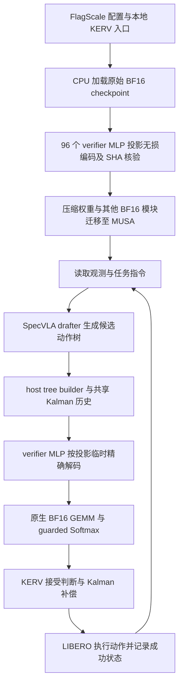

# KERV 在摩尔 MTT S5000 上的适配、推理优化与保精度压缩技术报告

| 文档项 | 内容 |
| --- | --- |
| 文档版本 | V1.0，2026-10-28；面向甲方技术交付与结果核验 |
| 本次修订范围 | 汇总已有部署、算子及量化实验，补齐技术原理、指标定义、部署选择和验收边界；本次文档修订未重新运行模型 |
| 最新实验批次 | `outputs/task_aware_quantization/20261028T022212Z` |
| 当前部署选择 | `RETAIN_VERIFIED_EXACT_BF16`，保留 96 个 verifier MLP 投影的无损 BF16 存储配置 |
| 测试范围 | 本机单张摩尔 MTT S5000，OpenVLA verifier + SpecVLA drafter，LIBERO-Goal 本地仿真 |
| 主要依据 | [TestOutline.md](../../TestOutline.md)、[本轮原始汇总](../../outputs/task_aware_quantization/20261028T022212Z/reports/local_results.json)、[最终选择记录](../../outputs/task_aware_quantization/20261028T022212Z/inventory/selection.json) |

本报告是封存后的说明文档。实验目录、原始日志、失败记录、校验清单及其中的源码归档保持原样；归档中的文档是封存时版本，不包含本次新增报告。交付时应同时提供本文、操作指南与完整证据目录。

## 1. 交付结论

本机已经完成通过 FlagScale 启动的 KERV/SpecVLA drafter 推理链路适配，实际执行后端为 `torch_musa`，定制解码内核由 Triton MUSA 执行。FlagOS/KERV Runtime 提供既有优化接口，本地代码完成设备接口、算子及推理入口适配；不能将本机结果直接外推为其他芯片已通过验证。

本阶段按“任务成功率优先，允许动作差异”的要求筛选量化方案。七类有损候选均未完成 `task0/state0/seed7` 抽屉任务，暂不推荐部署。即使少数候选在另一任务成功，或权重重建误差很小，也不足以改变这一选择。

当前保留无损 BF16 存储配置。它在 CPU 加载时压缩 verifier 的 96 个 MLP 投影，在使用时精确恢复 BF16 权重，再调用原生 BF16 GEMM。本轮独立冷进程配对复测得到：

| 核心结果 | 本轮实测 | 可以支持的结论 |
| --- | --- | --- |
| 任务质量 | BF16 对照与推荐配置均在 170 步成功；170/170 动作 token、原始动作、执行动作及观测一致 | 本次 task/state/seed 的任务行为保持一致 |
| 权重保真 | 96/96 个投影在 MUSA 上解码后的 SHA256 与原 BF16 一致 | 所选投影没有引入权重数值误差 |
| 静态权重存储 | 减少 2,122,448,562 bytes | 压缩存储有效；不等于设备峰值下降量 |
| allocated 峰值 | 16.879316 → 14.772259 GB，减少 **2.107058 GB（12.48%）** | 本轮框架分配峰值下降 |
| reserved 峰值 | 17.223909 → 15.130952 GB，减少 **2.092958 GB（12.15%）** | 本轮框架预留峰值下降 |
| 排除首步的模型均值 | 261.860 → 312.572 ms，**增加 19.37%** | 压缩以额外解码时间换取显存；本轮没有新增提速 |
| 最终针对性回归 | 37 项通过 | 已覆盖相应编码、解码及部署接口检查 |
| 证据封存 | 988 个文件，独立完整性校验 PASS | 封存时文件与校验清单相符 |

当前推荐适用于希望减少显存占用、同时保留原 BF16 权重的部署场景。对于延迟优先且显存充足的场景，可继续使用配对测试中的未压缩 BF16 参考入口。本轮没有得到兼顾上述显存收益和相对 BF16 提速的新方案。

上述结果属于本地阶段自测。完整 LIBERO 套件成功率、A100 正式性能、三款国产芯片及第三方测试仍需按任务书分别验收。

## 2. 系统组成与实际执行路径

### 2.1 组件分工

| 组件 | 本机承担的工作 | 交付定位 |
| --- | --- | --- |
| KERV | 推测动作树、verifier 验证、动态接受阈值、Kalman 纠错补偿与动作生成 | 推理算法主干 |
| SpecVLA | 提供本机使用的 LIBERO-Goal drafter 权重；历史正式对照使用独立移植入口 | drafter 来源与独立基线须分别说明 |
| OpenVLA | LIBERO-Goal verifier，负责视觉语言处理与候选动作验证 | 当前受测 VLA 模型 |
| FlagScale | 配置解析、任务启动和本地 KERV 推理入口调用 | 本地启动集成；公开发布或上游接收需另有记录 |
| FlagOS/KERV Runtime | 算子注册、运行时优化及 CPU/设备协作接口 | 本地 MUSA 适配所依据的运行时层 |
| `torch_musa` / muDNN | MUSA 张量运算、原生 BF16 GEMM、设备同步及内存管理 | 实际芯片后端与基础算子库 |
| Triton MUSA | BF16 存储解码、整数打包权重解码及算子原型 | 本阶段新增定制算子的执行工具 |
| LIBERO / MuJoCo / robosuite | 初始状态、动作执行、成功判定与仿真渲染 | 本轮任务质量的测量环境 |

FlagScale 配置中的 runner 选择不表示 OpenVLA 经 vLLM 引擎执行。实际加载和前向由本地 KERV/OpenVLA 代码完成。`KERV native` 仍包含 KERV 算法，不能重命名为原始 SpecVLA 基线。

### 2.2 本轮保留配置的链路



图中解码与 GEMM 在每次相关投影调用时发生。压缩入口没有保留整模型的 BF16 展开缓存。guarded Softmax、host tree builder、共享原标量 Kalman 历史及原生 BF16 GEMM 同时用于本轮参考和候选；静态树运行时与额外 Linear fusion 均关闭。

当前反馈历史来自模型生成的 action token/raw action；本轮没有接入真实机器人的关节传感器反馈。实现中的 CPU/设备分工仍须按 TestOutline 的正式指标及口径另行核对。

## 3. 环境、版本与可追溯性

| 项目 | 本轮记录 |
| --- | --- |
| 物理设备 | GPU0，MTT S5000，80 GiB；各完整模型运行串行执行 |
| 宿主机 / 容器工程路径 | `/root/KERV` / `/workspace` |
| 容器 / Python | `kerv-musa-runtime` / `/workspace/.venv/bin/python` |
| 驱动 | `3.3.5-server` |
| PyTorch / torch_musa | `2.9.1` / `2.9.1+a18d871` |
| Triton MUSA / Transformers | `3.2.0` / `4.40.1` |
| 已安装 muDNN | 3.3 系列；本轮未切换此前隔离验证过的 3.4 库 |
| verifier / drafter | `checkpoints/openvla-libero-goal` / `checkpoints/kerv-drafter` |
| Git 基点 | `4abb3dfdbe24783a738a23a893a6bd374beca0a3`；存在本地修改和新增文件，不能仅用 HEAD 标识实际运行源码 |
| 权重依赖 | 11 个依赖文件重新 SHA256 校验通过，原始 checkpoint 未修改 |
| 本轮源码归档 | `inventory/source_final.tar.gz`，329 个归档条目；不含容器和外部 checkpoint |

版本沿用上一轮环境；本轮没有升级驱动、SDK、框架或重新训练模型。精确依赖身份以[权重清单](../../outputs/task_aware_quantization/20261028T022212Z/inventory/weight_manifest.json)、各 run 的 `source_manifest.sha256` 和[最终源码归档](../../outputs/task_aware_quantization/20261028T022212Z/inventory/source_final.tar.gz)为准。源码归档不能单独替代模型权重和已安装容器环境。

此前 Softmax 问题、新版库对照与 PR 关闭记录保存在[专题报告](MOORE_SOFTMAX_LATEST_VERSION_20261027.md)。本轮两端沿用相同保护路径；现有证据没有把有损候选失败归因于新的 muDNN 故障，也没有定位到具体的量化误差放大分支。

## 4. 质量标准与实验设计

### 4.1 分层判断

| 检查层次 | 判定依据 | 当前作用 |
| --- | --- | --- |
| 编码和算子正确性 | CPU 编解码、保护组、边界、MUSA 解码 SHA、原生 GEMM 对照 | 排查实现错误；有损权重须与冻结的量化权重比较 |
| 流程完整性 | 退出码、完整 episode、逐步日志、无缺失采集 | `execution=PASS` 只说明流程完整 |
| 闭环任务质量 | 同任务/状态条件下环境实际返回的成功结果 | 有损候选的主要筛选依据，允许动作变化 |
| 行为诊断 | 同输入比较或相同轨迹下的 token/raw/执行动作及观测 | 帮助解释差异；不能替代成功率 |
| 性能与显存 | 相同运行时的配对延迟及独立冷进程内存峰值 | 评估具体部署配置的取舍 |
| 正式验收 | TestOutline 的模型、平台、芯片和第三方矩阵 | 不能由少量本地成功 episode 代替 |

对于无损存储，解码后的权重必须与原 BF16 逐位一致。对于有损方案，GPU 解码与冻结 payload 一致只能证明执行了设计的量化结果，仍需单独验证任务质量。

### 4.2 试点、扩展与停止规则

试点采用 `task0/state0` 与 `task1/state10`，随机种子均为 7，策略动作上限 220。task0 为 `open_the_middle_drawer_of_the_cabinet`。开始前稳定化仿真步骤另计，不计入策略动作数。筛选初期采用上一封存批次中 BF16 的成功记录：task0 为 170 步、task1 为 92 步；这些历史数据不用于本轮新的配对性能结论。

候选若在 BF16 已成功的试点失败，则不推荐。部分候选执行完两个试点以保留诊断，部分在首个失败后停止；每个分母按实际开始且完成的 episode 统计。候选筛选是自适应研发过程，不能把不同 policy 的成功数合并成一个模型的成功率。

预先登记的新状态为 `task0/state10`、`task1/state20`、`task2/state10`，种子 7。新候选通过试点及性能筛选后，才进入这些状态的全新 BF16 配对。本轮没有候选满足进入条件，因此三组新状态均未执行，不计入成功率分母。

最终另外执行了本轮新启动的 BF16 对照、全保护组打包控制、原无损配置复测各一次。因此共 14 个完整 episode：11 个有损试点、3 个控制/复测。原始登记包括未执行项，见[完整执行状态](../../outputs/task_aware_quantization/20261028T022212Z/inventory/execution_status.json)。

一次普通 W10 的第二试点在 episode 开始前被空闲检查拦截：CPU 权重构建进程初始化 MUSA 并占用 2 MiB 上下文。该项属于未启动，不计任务失败；原日志保留。后续构建和设备任务串行执行，没有重置设备或终止无关进程。

## 5. 保留方案：无损 BF16 存储压缩

### 5.1 编码原理

BF16 每个权重由 1 位符号、8 位指数和 7 位尾数组成。本方案对每组 128 个权重选取指数基值 `base=max(max_exponent−15, 0)`，用 4 位保存组内指数差，另用 8 位保存原符号和尾数。主体每个权重为 12 位，两个权重打包为 3 个字节。

指数低于该组可表示范围的权重保存在稀疏异常表中，包括原始索引与原始 BF16 值；GPU 先恢复主体，再补回异常值。因此主体、基值和异常表合起来能够精确恢复原来的 16 位 BF16。实际总存储还包含基值与异常表开销，不能把“主体 12 位”直接写成所有权重固定节省 25%。

该机制与有损整数 W12 不同。前者保留原始 BF16 位模式，后者以整数乘 scale 近似原权重。当前推荐 policy 的整数模块列表为空，只有 `exact_bf16_groups=["verify_mlp"]`；其中 `module_count=0` 表示没有预制整数 payload，实际载入后压缩投影数为 96。

### 5.2 加载与运行

1. 在 CPU 上加载原始 BF16 参数并核验身份，对选定 MLP 投影编码，验证 CPU 逐位还原。
2. 将压缩主体、指数基值和异常表迁移到 MUSA；attention、vision、drafter、head、KV 保持 BF16。
3. 每次使用投影时在设备上生成临时 BF16 权重，调用原生 BF16 GEMM，随后由运行时管理临时张量。
4. 审计设备实际解码 SHA 与原始权重 SHA，同时记录真实 forward 命中，防止只验证未使用的编码器。

这个实现减少常驻权重存储，同时增加解码、临时张量写入及调度开销。本轮测得的 19.37% 模型均值增长是总体观测，尚未将增量时间逐项归因到上述各部分。

源码入口：[无损编码器](../../src/runtime_opt/KERVRuntimeOptimization/lossless_bf16.py)、[MUSA 解码内核](../../src/runtime_opt/KERVRuntimeOptimization/lossless_bf16_kernels.py)、[精度配置加载入口](../../src/openvla/experiments/robot/libero/run_precision_libero.py)、[启动脚本](../../src/scripts/run_musa_precision.sh)。

## 6. 本轮配对结果与指标口径

### 6.1 唯一主配对

参考 run：`control_fresh_bf16_task0_state0_s7`；推荐配置 run：`comparison_old_exact_mlp_task0_state0_s7`。两端均为独立冷进程、相同 task/state/seed 与相同保护路径。数字来源为[配对检查 JSON](../../outputs/task_aware_quantization/20261028T022212Z/reports/recommended_exact_recheck.json)。

| 指标 | 未压缩 BF16 参考 | 推荐无损存储 | 说明 |
| --- | ---: | ---: | --- |
| 任务成功 / 策略动作数 | 成功 / 170 | 成功 / 170 | 两个 episode 各自读取环境结果 |
| 观测、token、raw、执行动作 | 参考 | 各 170/170 一致 | 第一差异位置均为空 |
| 实际设备解码与原权重 SHA | 原始 BF16 | 96/96 一致 | 不依赖 CPU 编码正确性推断 GPU 结果 |
| allocated 峰值 bytes | 16,879,316,480 | 14,772,258,816 | 减少 2,107,057,664 bytes |
| reserved 峰值 bytes | 17,223,909,376 | 15,130,951,680 | 减少 2,092,957,696 bytes |
| 首步模型耗时 ms | 9,100.771 | 8,620.541 | 保留冷启动懒初始化影响，不并入稳态均值 |
| 排除首步模型样本数 | 169 | 169 | 仅移除各 episode 第一个策略动作 |
| 模型均值 ms | 261.860 | 312.572 | 延迟增加 19.37% |
| 模型中位数 ms | 270.448 | 324.821 | 同一统计窗口 |
| 模型 P95 ms | 408.449 | 487.954 | nearest-rank 百分位 |
| pipeline 均值 ms | 273.450 | 324.143 | 延迟增加 18.54% |
| pipeline 中位数 ms | 281.795 | 336.579 | 排除首步 |
| pipeline P95 ms | 420.063 | 499.961 | 排除首步 |
| 闭环 wall time s | 81.541 | 89.348 | 本轮观测增加 9.57%；窗口定义见下文 |

GB 为 `10^9 bytes`，GiB 为 `2^30 bytes`。allocated 节省 2.107058 GB 对应 1.962350 GiB，reserved 节省 2.092958 GB 对应 1.949219 GiB；单位不得互换。框架 allocated/reserved 不等于 `mthreads-gmi` 的整卡或进程占用，本文不把两者混用。

### 6.2 时间、峰值与计算公式

模型耗时来自策略生成区间；pipeline 覆盖该步的观测处理及策略生成，到进入环境执行前结束。闭环 wall time 从首个传入观测开始，到最终 `env.step` 及逐步日志结束，排除模型加载、初始稳定化和视频保存。因此这些数字不能当作从启动命令到进程退出的总耗时，也不等同于任务书的 A100 `65 s/task` 参考。

内存峰值取独立冷进程从模型加载到退出的采集窗口；采集器阶段重置峰值后，由汇总器取所有记录的最大值。静态权重节省取编码前后存储差，不用它代替 allocator 峰值。

```text
allocated 峰值节省 = 16,879,316,480 − 14,772,258,816
                   = 2,107,057,664 bytes
模型均值增幅       = (312.5717068675178 / 261.8600654046564 − 1) × 100%
                   = 19.365931717956265%
```

本轮为一次冷进程配对观测，未给出多次配对置信区间。对于有损候选，一旦动作不同，后续观测、树结构和步数也可能不同，故不将不同闭环轨迹的平均耗时之比称为同工作量算子加速，也不计算错位轨迹逐步动作 MAE。

### 6.3 历史覆盖与本轮复测

上一封存批次验证了 `task0/state0` 和 `task1/state10` 两对 BF16/无损配置，均成功，合计 262/262 动作及观测一致；按排除每个 episode 首步后剩余帧数加权，模型均值为 256.767 → 309.333 ms，增加 20.47%。见[2026-10-27 精度报告](MOORE_PRECISION_REFINEMENT_20261027.md)。

本轮 task0 是其中一个已见 task/state 的复测，不增加第三个独立场景。历史两对与本轮单对分开报告，不混合生成新的成功率或延迟倍率。

## 7. 有损混合量化：实现与筛选结果

### 7.1 候选机制和实际闭环

| 候选 / run 前缀 | 有损范围与机制 | task0/state0 | task1/state10 | 成功/实际 episode | 选择 |
| --- | --- | --- | --- | ---: | --- |
| 校准 INT8 / `pilot_int8` | 75 个既有校准投影，保护组保留 BF16 | 失败，220 步 | 成功，89 步 | 1/2 | 不推荐 |
| RTN W10 / `pilot_w10` | 75 投影，10 位整数打包、FP32 scale，沿用保护组 | 失败，220 步 | 未启动，资源检查拒绝 | 0/1 | 不推荐 |
| RTN W10 pow2 / `pilot_w10_pow2` | 75 投影，scale 限制为 2 的整数次幂，保存 int8 指数 | 失败，220 步 | 成功，94 步 | 1/2 | 不推荐 |
| 真实树 GPTQ W10 / `pilot_tree_gptq_w10` | 75 投影，真实提示词与验证树激活校准，BF16 舍入参与误差反馈 | 失败，220 步 | 首试点失败后停止 | 0/1 | 不推荐 |
| up-only GPTQ / `pilot_tree_gptq_up_hybrid` | 25 个 up 投影 W10，其余 71 个 MLP 投影无损存储 | 失败，220 步 | 首试点失败后停止 | 0/1 | 不推荐 |
| 少量 W12 / `pilot_w12_up8` | 8 个历史低敏感度 up 投影 RTN W12/pow2，其余 88 个 MLP 投影无损 | 失败，220 步 | 失败，220 步 | 0/2 | 不推荐 |
| 近零 BF16 / `pilot_nearzero` | 96 个 MLP 投影仅舍弃极小值，其余位精确，省去异常值补写 | 失败，220 步 | 成功，87 步 | 1/2 | 不推荐 |

以上 11 个 episode 的执行状态均为 PASS，表示流程完成且采集完整；表中“失败”是达到 220 步仍未完成任务。七类候选均未满足试点质量要求，未进入正式任务成功率验证。RTN 表示直接按量化网格舍入；本轮普通 RTN W10/W12 没有重新做 GPTQ。

新整数解码实现支持 10/12 位打包、保护组原始 BF16 覆盖及 pow2 scale 指数还原。运行时仍解码至 BF16 后调用原生 GEMM，没有启用硬件原生 INT10/INT12 GEMM，也未量化激活或 KV cache。机制及参数须按具体 policy 区分，不能把各方案的显存和任务结果拼成一个配置。

### 7.2 真实推测树激活校准

校准集 C 为冻结的三个轨迹：task0/1/2 的 state3、seed7，每条抽取 24 帧，共 72 帧。另有 36 帧已见诊断集 V。入口恢复对应观测和动作/Kalman 历史，运行实际 KERV 提示词及推测验证树，采集 MLP 输入。

选择层 2–27，排除 23，共 25 层。每次调用最多抽取 32 行 prompt 输入或 16 行 tree 输入，二者分别采样；每层设置训练行上限 8192、诊断上限 4096，CPU 抽样 seed449。具体实际行数保存在[采样清单](../../outputs/task_aware_quantization/20261028T022212Z/tree_gptq_pow2_w10/sampling.json)。

每个 MLP 块使用原 BF16 上游输入；gate/up 量化后再生成同块 down 的输入。GPTQ 的误差反馈包含部署时的 BF16 解码舍入，整数分组为 32 列，保护比例 5%，alpha=0。局部 MLP 输出相对 RMSE 超过 1% 的块保留 BF16；25 个块的诊断值约为 0.314%–0.525%，均满足局部门限，但完整 W10 和 up-only 混合方案仍在 task0 失败。

该校准没有逐块传播完整量化模型的上游误差；V 也不是未见任务测试集。采集使用 native 树路径并补入 guarded Softmax，部署采用 host tree/shared history，路径差异有记录。校准采样、耗时和显存不计入部署性能。

### 7.3 为什么不能只看权重 RMSE

| 重建诊断 | 整体相对权重 RMSE | 观察 |
| --- | ---: | --- |
| 75 投影旧 INT8 | 0.007405621 | W10 构建时的历史权重比较参考 |
| 75 投影 RTN W10 / FP32 scale | 0.001132139 | 权重重建改善，task0 仍失败 |
| 75 投影 RTN W10 / pow2 scale | 0.001616149 | 权重重建改善，task0 仍失败 |
| 8 个 up 投影 RTN W12 / pow2 | 0.000207508 | 仅指这 8 个有损投影；两个试点均失败 |
| 96 投影近零 BF16 | 约 1.487448e-7 | 权重扰动极小，仍未完成 task0 |

近零方案在 4,328,521,728 个权重中只将 18,963 个非零值映射为同符号零，约占 0.000438%；其余值保留原始 BF16 位。单个权重绝对误差不超过所属原始组最大绝对值的 `1/32768`，基值为零时保留次正规值。CPU 检查误差界及保留值位模式，GPU 解码与构建结果一致。

本轮可以确认：这些具体候选较小的权重误差及局部重建误差，并未保证抽屉任务完成。尚不能确认是哪层误差、哪个 posterior/阈值判断或哪次 Kalman 补偿导致了最终失败；也不能据此否定所有混合量化方法。后续应在同输入下追踪首个 logits、接受分支或补偿分歧，再确定需要保护的计算位置。

### 7.4 全保护组打包控制

额外构建控制：8 个 W12 打包投影的所有列组均保存原 BF16，其他 88 个 MLP 投影仍使用原无损存储。它与新 BF16 对照均在 170 步成功，170/170 动作及观测一致，96 个设备解码 SHA 与原权重一致。见[控制检查结果](../../outputs/task_aware_quantization/20261028T022212Z/reports/exact_packed_control.json)。

该控制支持本次场景中打包及覆盖路径可以保真，但其存储含冗余，不作为推荐部署配置，也不能用一个成功控制排除所有运行时故障。控制结果没有证明某个具体误差放大机制。

## 8. 解码算子优化与未采用方案

原无损实现先恢复主体，再以稀疏索引补写异常值。本轮尝试将两步合并或降低主体读取开销，所有原型均做设备逐位验证，并在真实 layer15 的 gate/up/down 权重上微基准测试。

| 原型 | 实现思路 | 解码倍率 | 解码 + 原生 GEMM 倍率 | 本轮处理 |
| --- | --- | ---: | ---: | --- |
| CSR 融合初版 | 通过分段异常索引在解码 CTA 中恢复异常值，避免单独 scatter | 0.8275–0.8320× | 0.8379–0.9014× | 更慢，不接入 |
| CSR 静态展开 | 小异常数时展开恢复过程 | 0.6672–0.7643× | 0.7296–0.8532× | 更慢，不接入 |
| 两级精确字典，1024/4 | 两次查表并核对完整 key，恢复非零异常值 | 0.3513–0.3562× | 0.4275–0.5037× | 更慢，不接入 |
| 两字节拆位，1024/4 | 减少每个 12 位码的读取拆位，保留原异常补写 | 1.0016–1.0141× | 0.9771–1.0034× | 未取得稳定 Linear 收益，不接入 |

倍率定义为原无损参考耗时 / 候选耗时，大于 1 才表示提速。`1024/4` 表示该组配置的 block size/num_warps；上表范围只对应表中配置和受测形状，更慢的其他配置同样保留在原始结果中。

微基准固定 M=1/8/279，先预热 4 次，再测 8 组、每组 20 次，在批次边界同步，AB/BA 交替顺序测量。所有解码权重先与原 BF16 核验。这是热算子测试，不能替代冷启动、整模型延迟或任务成功测试；上述原型均未进入完整模型推荐闭环。

相关源码为 [CSR 融合](../../src/runtime_opt/KERVRuntimeOptimization/inline_exact_bf16_kernels.py)、[两级字典](../../src/runtime_opt/KERVRuntimeOptimization/hash_exact_bf16_kernels.py)、[拆位原型](../../src/runtime_opt/KERVRuntimeOptimization/lossless_bf16_fast_kernels.py)。汇总与各原始结果路径见[算子汇总 JSON](../../outputs/task_aware_quantization/20261028T022212Z/reports/operator_summary.json)。

研发中曾出现两项实现/测试问题：字典夹具错误要求二级表非空，后增加随机冲突及强制二级命中；拆位原型初次编译出现 32/16 位 bitcast 不匹配，显式转为 uint16 后通过。失败和修复日志保留在 `operations/`，不归入闭环任务失败。

## 9. 历史推理收益与当前配置的关系

| 阶段 | 当时的比较对象 | 已有结论 | 本报告使用边界 |
| --- | --- | --- | --- |
| 2026-09-30 MUSA 部署与优化 | KERV native BF16 对 KERV optimized BF16 | 单个已见任务模型均值约 2.2713×，170 条动作一致 | 历史单回合结果，见[交付指南](../../README.md)；不外推为多轮或整套验收 |
| 2026-10-19 验收自测 | 新闭环三组及真实 SpecVLA 对照 | 仅 seed7 闭环完全一致；其余 seed 有分歧，部分正式指标未达到 | 见[阶段报告](MOORE_TEST_REPORT_20261019.md)，不能继续笼统称为三轮无损加速 |
| 2026-10-27 共享 Kalman 历史 | 同一量化策略，上一版 guarded 入口对共享历史入口 | 三轮 423/423 动作/token 一致，模型 1.1669×、pipeline 1.1600× | 是同一量化策略内部的运行时收益，其对原 BF16 的质量门槛仍未通过 |
| 2026-10-27 无损 MLP | 未压缩 BF16 对 96 投影无损 BF16 存储 | 两对任务成功，262/262 一致，模型均值增加 20.47% | 支持高保真存储压缩路线 |
| 2026-10-28 本轮 | 同保护路径的新 BF16 对原无损 MLP 复测 | 170/170 一致，allocated 节省 2.107 GB，模型均值增加 19.37% | 当前部署取舍的主要依据 |

各阶段的参考、权重、Softmax 保护路径及受测场景不同，倍率不相乘，不组合成一个“最终加速倍数”。其他机器报告的 471 动作、2.10×/2.08×结果未作为本机证据纳入本报告；跨机器比较应先统一硬件、权重、运行时、计时窗口及输入轨迹。

## 10. 对照 TestOutline 的验收状态

| 要求 | 本机已有证据 | 当前可报告状态 / 后续缺口 |
| --- | --- | --- |
| 摩尔适配及完整闭环 | 本机真实权重、MUSA 执行、动作及环境成功记录 | 本地场景已执行，不能代替全部型号矩阵 |
| 任务成功率损失 <5% | 小样本候选筛选及 BF16/无损配对 | 未验证套件级界限；需确认相对百分比/百分点口径并扩大冻结矩阵，也未证明 ≤1 个百分点 |
| A100 相对 SpecVLA 提速 20% | 本机 MUSA 的历史及当前测量 | 本轮未测试 A100，不能填写为正式指标通过 |
| 平均接受长度提升 >0.5 | 历史采集与阶段报告 | 本轮压缩实验未补齐该正式结论；不得用动作数或本地时间差代替 |
| CPU–GPU 传输 <100M/s | 本轮未形成新的完整双向传输测量结论 | 仍需按正式窗口和单位补齐；不能用解码速度推算 |
| P06 节省 2GB 以上显存 | 相对本轮 BF16 的 allocated 下降 2.107 GB，伴随延迟增加 | 属于本地存储压缩收益；参考对象、同精度异构部署及设备/进程口径仍需正式 P06 配对验证 |
| 两类 VLA、至少三平台 | OpenVLA + LIBERO-Goal；SpecVLA 在此主要为 drafter 来源 | 未覆盖智源自研 VLA 及其他认可平台；drafter 不重复计作第二类 VLA |
| 不少于三款国产芯片 | 本轮只执行 MTT S5000 | 其他芯片由各节点独立记录，本报告不代为判定 |
| 按 FlagScale 设计集成并开源 | 本地启动入口、配置和适配代码 | 本地可运行不等于已公开发布或上游合并，须另附仓库版本与发布证据 |
| 第三方验收 | 本地操作、日志、校验及归档 | 可供第三方复算；尚非第三方签署报告 |

本报告可作为摩尔节点技术交付和自测材料。任务书其他成果及证明材料继续以 TestOutline 和对应档案为准，本次文档完善不改变正式验收状态。

## 11. 部署、复现与回退

### 11.1 使用明确的推荐 policy

推荐文件：[deployment_policy.json](../../outputs/task_aware_quantization/20261028T022212Z/recommended_exact_mlp/deployment_policy.json)。其 SHA256 为：

```text
c36da97d0e13c2d69c3926014f2962831ef7b5271982de22849866187b8bc475
```

本轮实际运行引用上一批 `exact_mlp/deployment_policy.json`；封存目录的推荐副本与之逐字节一致。这一选择保留了已测试配置，没有把未通过的有损 payload 放入推荐文件。

以下在宿主机执行，使用现有容器及权重。命令生成新的时间戳目录，不写入封存实验目录。当前源码若有后续变更，应先与封存源码核对；本命令不自动覆盖工作区为归档版本。

```bash
cd /root/KERV/src
policy_file=/root/KERV/outputs/task_aware_quantization/20261028T022212Z/recommended_exact_mlp/deployment_policy.json
sha256sum "$policy_file"

quant_report_run_stamp=$(date -u +%Y%m%dT%H%M%SZ)
KERV_PRECISION_POLICY=/workspace/outputs/task_aware_quantization/20261028T022212Z/recommended_exact_mlp/deployment_policy.json \
  bash scripts/run_musa_precision.sh --max-tasks 1 --trials 1 \
  --max-episode-steps 220 \
  --output-dir "/workspace/outputs/manual_task_aware_exact_${quant_report_run_stamp}"
```

这是现有部署入口的手工复测示例。正式验收重跑还需用冻结 case 清单、采集器和唯一 run ID，不能仅凭手工运行视频替代本报告的配对证据。完整步骤见[操作指南](../../src/docs/MUSA_TASK_AWARE_QUANTIZATION.md)。

### 11.2 检查运行是否命中

审阅原始记录时依次检查：policy SHA 与推荐值一致；loaded 审计显示 exact_module_count=96、lossy_module_count=0；96 个 GPU 解码 SHA 均等于原始 BF16；final 审计记录真实 forward 调用及相同 Softmax/Kalman 路径；`episodes.jsonl` 中 task_success 与步数完整；`steps.jsonl` 中动作和观测可追溯。

配置中 `w8a16.enabled=true` 是复用既有分发挂钩，不能据字段名推断启用了 INT8。本轮实际编码以 precision manifest 和每个模块的 storage 记录为准。日志检查文件由正式采集器生成，手工入口是否生成相同完整采集，取决于是否按操作指南设置验收上下文。

### 11.3 回归与回退

最终回归共 37 项，命令及退出码见[回归操作记录](../../outputs/task_aware_quantization/20261028T022212Z/operations/final_targeted_regression/command.json)，原始输出见[测试日志](../../outputs/task_aware_quantization/20261028T022212Z/operations/final_targeted_regression/stdout_stderr.log)。覆盖 `test_packed_intn`、`test_packed_pow2`、`test_precision_storage`、`test_calibrated_packed`、`test_calibrated_int8`、`test_nearzero_bf16`、`test_inline_exact_bf16`、`test_hash_exact_bf16`、`test_lossless_fast_decode`。37 为最终一次不重复计数的测试数，不累加此前重跑。

需要回退显存压缩时，切回[本轮 BF16 参考入口](../../src/openvla/experiments/robot/libero/run_precision_reference_libero.py)，保留相同 guarded Softmax、host tree/shared history 与原生 GEMM，取消权重替换。参考的完整冻结启动参数见[参考 run](../../outputs/task_aware_quantization/20261028T022212Z/runs/control_fresh_bf16_task0_state0_s7/)。直接切换到早期 optimized 默认配置会同时改变其他优化开关，不是本轮同条件回退。

所有 GPU 测试与构建应串行；运行前确认资源可用，不通过关闭空闲检查绕过资源冲突。本次报告修订未重新触发设备测试，37 项通过引用既有封存结果。

## 12. 证据索引与完整性核验

以下路径相对工程根目录 `/root/KERV`。只交付本文中的截图或汇总表不足以复算，须同时保留关联的原始目录。

| 证据 | 文件 / 目录 | 用途 |
| --- | --- | --- |
| 本轮机器可读汇总 | [reports/local_results.json](../../outputs/task_aware_quantization/20261028T022212Z/reports/local_results.json) | 14 个 run 与候选、算子及测试汇总 |
| 冻结清单和执行状态 | [inventory/](../../outputs/task_aware_quantization/20261028T022212Z/inventory/) | cases.csv、15 份附加清单、未启动与未执行状态 |
| 最终部署选择 | [inventory/selection.json](../../outputs/task_aware_quantization/20261028T022212Z/inventory/selection.json) | 推荐 policy、哈希及保留原因 |
| 本轮主配对 | [reports/recommended_exact_recheck.json](../../outputs/task_aware_quantization/20261028T022212Z/reports/recommended_exact_recheck.json) | 动作、观测、权重和资源差异 |
| 全保护打包控制 | [reports/exact_packed_control.json](../../outputs/task_aware_quantization/20261028T022212Z/reports/exact_packed_control.json) | 隔离打包/保护组路径 |
| 逐步与 episode 原始数据 | [runs/](../../outputs/task_aware_quantization/20261028T022212Z/runs/) | run.json、steps/episodes、精度审计、显存与视频 |
| 校准协议与抽样 | [tree_gptq_pow2_w10/](../../outputs/task_aware_quantization/20261028T022212Z/tree_gptq_pow2_w10/) | protocol/sampling/layers/policy、激活数据 |
| 算子原始结果入口 | [reports/operator_summary.json](../../outputs/task_aware_quantization/20261028T022212Z/reports/operator_summary.json) | 链接对应 benchmark/results.json 及批次样本 |
| 原始命令与失败日志 | [operations/](../../outputs/task_aware_quantization/20261028T022212Z/operations/) | argv、工作目录、起止时间、退出码及 stdout/stderr |
| 权重与依赖 | [inventory/weight_manifest.json](../../outputs/task_aware_quantization/20261028T022212Z/inventory/weight_manifest.json)、[reports/dependencies_checked.json](../../outputs/task_aware_quantization/20261028T022212Z/reports/dependencies_checked.json) | 11 个文件身份与重新校验记录 |
| 本轮源码归档 | [inventory/source_final.tar.gz](../../outputs/task_aware_quantization/20261028T022212Z/inventory/source_final.tar.gz) | 329 个归档条目及配套 manifest，保留封存时版本 |
| 实验证据校验清单 | [checksums.sha256](../../outputs/task_aware_quantization/20261028T022212Z/checksums.sha256) | 988 个封存文件的逐文件 SHA256 |
| 独立校验结果 | [批次外完整性检查](../../outputs/task_aware_quantization/20261028T022212Z.integrity_check.json) | 封存后第二次校验 PASS，无失败 |
| 本次说明文档版本 | [文档修订清单](MOORE_TECHNICAL_REPORT_20261028.manifest.json) | 本报告及同步文档的 SHA256，与实验证据分开记录 |

封存校验清单的 SHA256 为 `4e3407572f52f0c2d9d46af10fc2793f0a46cb760e16aeda9e13691f06450020`。独立检查于 2026-10-28 03:48:58 UTC 完成，校验 988 个文件，无失败。以下命令只读检查原封存目录：

```bash
cd /root/KERV/outputs/task_aware_quantization/20261028T022212Z
sha256sum checksums.sha256
sha256sum -c checksums.sha256
```

不要在封存目录内重新运行生成报告的脚本。需要复算派生 JSON/Markdown 时，先完整复制到新的工作目录，再按操作指南执行；新增输出留在副本，原始记录继续保留。文件完整性校验 PASS、算子正确、某个任务成功与正式任务书验收是不同结论。

## 13. 后续优化安排

后续先定位有损候选的任务退化，再扩大位宽和保护策略搜索。建议以固定输入捕获首个 verifier logits、posterior 选择、阈值和 Kalman 补偿分歧，分别对敏感投影、敏感列组及敏感验证阶段做回退对照。误差来源得到控制后，冻结新的 policy，在未参与筛选的任务/初始状态上进行同运行时 BF16 配对。

算子方面应围绕现有无损解码的真实模型剖析决定方向，保留解码、GEMM、调度及临时内存的分项时间；只有 Linear 端到端稳定获益，才进入完整闭环。增加缓存或预取时同时计入新增常驻/临时显存，不能用缓存后的耗时和未缓存的显存拼接指标。

候选进入下一阶段需依次具备：编码/设备核验通过，试点无任务退化，独立状态配对结果可复算，性能和显存取舍满足部署需求。套件级成功率及正式任务书矩阵仍单独组织测试，不以研发小样本提前宣布通过。
